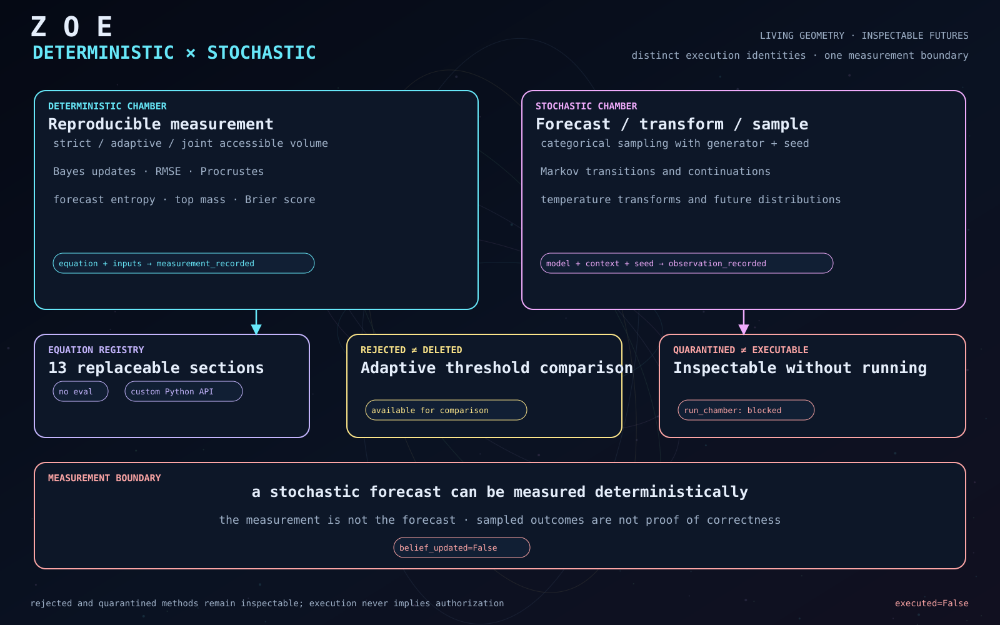

# ZVA-0237 — P Icon Starred

[Visual archive index](../../README.md) · [Full catalog](../README.md) · [Category: Identity, emblems, and interface icons](../categories/branding.md)

## What this image shows

A compact GEM/GUIAI interface glyph for the “starred” action or state, supplied in the project’s icon set. This visual supports recognition, navigation, application identity, or a cohesive visual language across Zoe and its components.

## Role in Zoe

This visual supports recognition, navigation, application identity, or a cohesive visual language across Zoe and its components.

## Provenance and evidence boundary

**Provenance:** Project identity or interface asset.

Functional and identity artwork does not constitute research evidence.

## File identity

- Archive ID: **ZVA-0237**
- Visual family: **p-icon--starred**
- Dimensions/format: **SVG 16×16**
- Frames: **vector/not applicable**
- Bytes: **217**
- SHA-256: `0a6ed4e9e4f9ffc2699d4440bdcfe949eb1757ab9078ea79767e192c19167dc4`
- Original file: [Open full resolution](../../images/ZVA-0237.svg)

## Source occurrences

Byte-identical copies are archived once while every known source path remains recorded.

| Source repository/collection | Original path | Canonical link |
|---|---|---|
| zoe | `components/ablation/gem-lab/gem/icons/p-icon--starred.svg` | [Source](https://github.com/Ablation-Tool/zoe/blob/main/components/ablation/gem-lab/gem/icons/p-icon--starred.svg) |
| zoe | `components/graphics-environment-manager/gem/icons/p-icon--starred.svg` | [Source](https://github.com/Ablation-Tool/zoe/blob/main/components/graphics-environment-manager/gem/icons/p-icon--starred.svg) |
| zoe | `guiai-lab/build/lib/guiai/icons/p-icon--starred.svg` | [Source](https://github.com/Ablation-Tool/zoe/blob/main/guiai-lab/build/lib/guiai/icons/p-icon--starred.svg) |
| zoe | `guiai-lab/guiai/icons/p-icon--starred.svg` | [Source](https://github.com/Ablation-Tool/zoe/blob/main/guiai-lab/guiai/icons/p-icon--starred.svg) |
