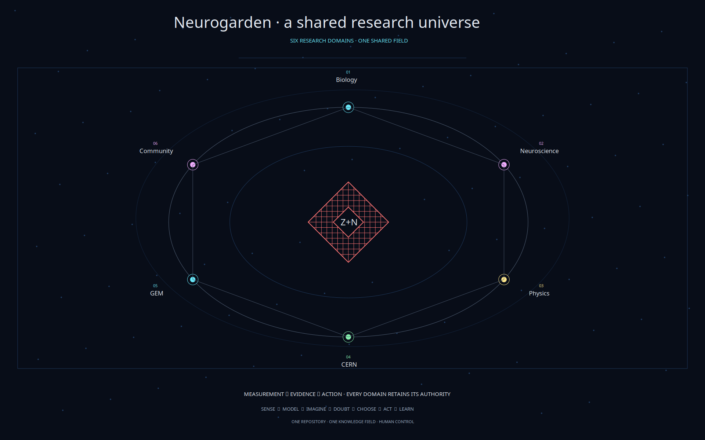

# ZVA-0241 — CERN Universe

[Visual archive index](../../README.md) · [Full catalog](../README.md) · [Category: Mechanism and architecture diagrams](../categories/mechanism-diagram.md)

## What this image shows

A research-universe diagram linking biology, neuroscience, physics, CERN, GEM, and community while keeping their evidence and permission domains distinct. This visual belongs to Zoe’s CERN/source-evidence program, helping a reader inspect a corpus, protocol, replay, virtual system, or process boundary.

## Role in Zoe

This visual belongs to Zoe’s CERN/source-evidence program, helping a reader inspect a corpus, protocol, replay, virtual system, or process boundary.

## Provenance and evidence boundary

**Provenance:** Zoe source-derived research scene.

CERN material is source evidence or a virtual/synthetic model, not live detector state or hardware authorization.

## File identity

- Archive ID: **ZVA-0241**
- Visual family: **cern-universe**
- Dimensions/format: **1920×1200 PNG**
- Frames: **1**
- Bytes: **130,851**
- SHA-256: `4da85a0ac7fa8c0bb2661d9e48d49d48c9ddd03b159b32ccffcb8412ccd42932`
- Original file: [Open full resolution](../../images/ZVA-0241.png)

## Source occurrences

Byte-identical copies are archived once while every known source path remains recorded.

| Source repository/collection | Original path | Canonical link |
|---|---|---|
| zoe | `components/agent-logging-system/docs/images/cern-universe.png` | [Source](https://github.com/Ablation-Tool/zoe/blob/main/components/agent-logging-system/docs/images/cern-universe.png) |

## Documented context

### Neurogarden · a shared research universe

Source document: `zoe:research/papers/zoe-research/docs/neurogarden/WORLD.md`

CERN and the six research domains

### 1. Cern universe

Source document: `zoe:research/papers/galleries/zoe-cern/README.md`

CERN research in Zoe — Visual research index: Cern universe

`assets/neurogarden/cern-universe.png`

### 93. Cern universe

Source document: `zoe:research/papers/galleries/zoe-research/README.md`

Complete Zoe research asset index: Cern universe

`assets/neurogarden/cern-universe.png`

### Neurogarden · a shared research universe

Source document: `zoe:components/agent-logging-system/docs/WORLD.md`

CERN and the six research domains

## Related format/size variants

- [ZVA-0242](ZVA-0242.md)
