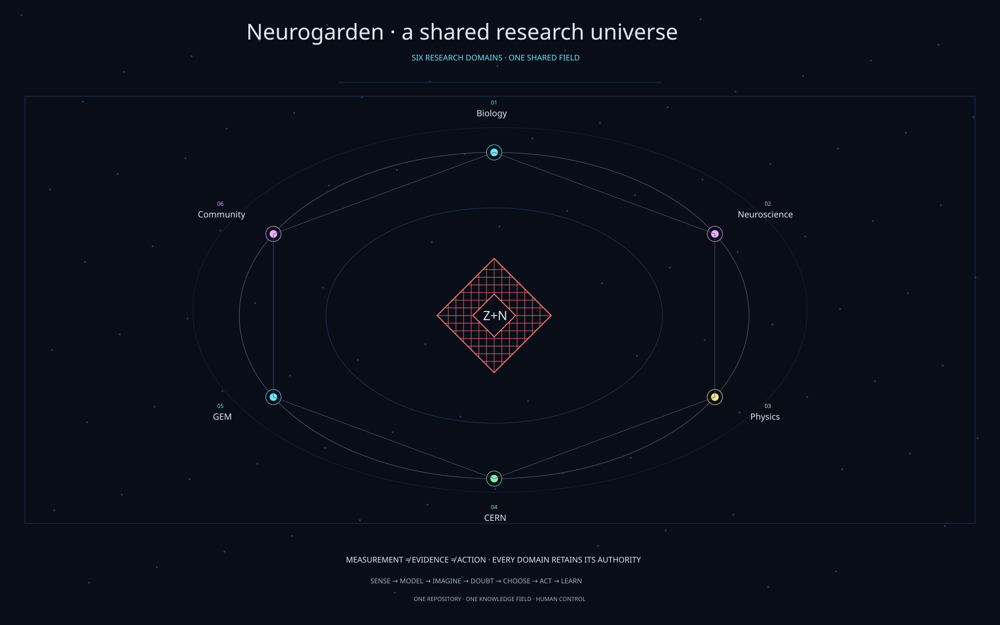

# ZVA-0242 — CERN Universe

[Visual archive index](../../README.md) · [Full catalog](../README.md) · [Category: Mechanism and architecture diagrams](../categories/mechanism-diagram.md)

## What this image shows

A research-universe diagram linking biology, neuroscience, physics, CERN, GEM, and community while keeping their evidence and permission domains distinct. This visual belongs to Zoe’s CERN/source-evidence program, helping a reader inspect a corpus, protocol, replay, virtual system, or process boundary.

## Role in Zoe

This visual belongs to Zoe’s CERN/source-evidence program, helping a reader inspect a corpus, protocol, replay, virtual system, or process boundary.

## Provenance and evidence boundary

**Provenance:** Zoe source-derived research scene.

CERN material is source evidence or a virtual/synthetic model, not live detector state or hardware authorization.

## File identity

- Archive ID: **ZVA-0242**
- Visual family: **cern-universe**
- Dimensions/format: **SVG 1920×1200**
- Frames: **vector/not applicable**
- Bytes: **34,770**
- SHA-256: `be9527318637e44beb906da9badbc9d84d5480c9405729a286cfbeb562ee9a91`
- Original file: [Open full resolution](../../images/ZVA-0242.svg)

## Source occurrences

Byte-identical copies are archived once while every known source path remains recorded.

| Source repository/collection | Original path | Canonical link |
|---|---|---|
| zoe | `components/agent-logging-system/docs/images/cern-universe.svg` | [Source](https://github.com/Ablation-Tool/zoe/blob/main/components/agent-logging-system/docs/images/cern-universe.svg) |

## Related format/size variants

- [ZVA-0241](ZVA-0241.md)
