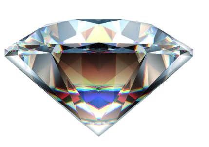

# ZVA-0244 — GEM Woven Diamond

[Visual archive index](../../README.md) · [Full catalog](../README.md) · [Category: Artwork and generative compositions](../categories/artwork.md)

## What this image shows

A faceted GEM diamond emblem used in the Neurogarden/shared research universe, distinct from the woven-diamond application-icon family. This is part of Zoe’s creative geometry and generative-art practice, preserving the artistic side of the project alongside its scientific instruments.

## Role in Zoe

This is part of Zoe’s creative geometry and generative-art practice, preserving the artistic side of the project alongside its scientific instruments.

## Provenance and evidence boundary

**Provenance:** Zoe/allgems project-generated visual.

The image is preserved with its source context; the visual alone does not prove a scientific or operational claim.

## File identity

- Archive ID: **ZVA-0244**
- Visual family: **gem-woven-diamond**
- Dimensions/format: **429×301 PNG**
- Frames: **1**
- Bytes: **116,090**
- SHA-256: `3485bc0e3ebd8edfad1efa56febc084e19124c5bfe1a4e1ee9882c0ae12bfdf3`
- Original file: [Open full resolution](../../images/ZVA-0244.png)

## Source occurrences

Byte-identical copies are archived once while every known source path remains recorded.

| Source repository/collection | Original path | Canonical link |
|---|---|---|
| zoe | `components/agent-logging-system/docs/images/gem-woven-diamond.png` | [Source](https://github.com/Ablation-Tool/zoe/blob/main/components/agent-logging-system/docs/images/gem-woven-diamond.png) |

## Documented context

### 95. Gem woven diamond

Source document: `zoe:research/papers/galleries/zoe-research/README.md`

Complete Zoe research asset index: Gem woven diamond

`assets/neurogarden/gem-woven-diamond.png`

## Related format/size variants

- [ZVA-0161](ZVA-0161.md)
- [ZVA-0162](ZVA-0162.md)
- [ZVA-0163](ZVA-0163.md)
- [ZVA-0164](ZVA-0164.md)
- [ZVA-0165](ZVA-0165.md)
- [ZVA-0166](ZVA-0166.md)
- [ZVA-0167](ZVA-0167.md)
- [ZVA-0168](ZVA-0168.md)
- [ZVA-0169](ZVA-0169.md)
