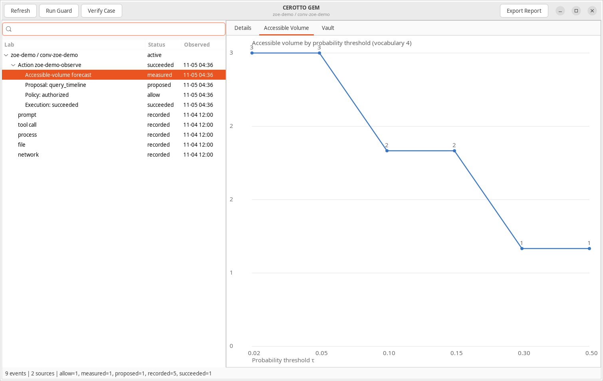

# ZVA-0246 — Cerotto GEM Accessible Volume

[Visual archive index](../../README.md) · [Full catalog](../README.md) · [Category: Research figures and measurements](../categories/research-figure.md)

## What this image shows

CEROTTO GEM synthetic case and accessible-volume sweep. This figure preserves a measurement, model output, simulation, geometric construction, or research explanation from the Zoe/allgems program.

## Role in Zoe

This figure preserves a measurement, model output, simulation, geometric construction, or research explanation from the Zoe/allgems program.

## Provenance and evidence boundary

**Provenance:** Zoe/allgems project-generated visual.

The image is preserved with its source context; the visual alone does not prove a scientific or operational claim.

## File identity

- Archive ID: **ZVA-0246**
- Visual family: **cerotto-gem-accessible-volume**
- Dimensions/format: **1510×956 PNG**
- Frames: **1**
- Bytes: **64,587**
- SHA-256: `fd7399d7ab0a664b4d352020466e60894f8c1c1d51d2e639cb5ae1bef67934fd`
- Original file: [Open full resolution](../../images/ZVA-0246.png)

## Source occurrences

Byte-identical copies are archived once while every known source path remains recorded.

| Source repository/collection | Original path | Canonical link |
|---|---|---|
| zoe | `components/cerotto/docs/images/cerotto-gem-accessible-volume.png` | [Source](https://github.com/Ablation-Tool/zoe/blob/main/components/cerotto/docs/images/cerotto-gem-accessible-volume.png) |
| zoe | `components/next-token-predictability/assets/cerotto-gem-gui.png` | [Source](https://github.com/Ablation-Tool/zoe/blob/main/components/next-token-predictability/assets/cerotto-gem-gui.png) |
| zoe | `guiai-lab/docs/images/cerotto-gem.png` | [Source](https://github.com/Ablation-Tool/zoe/blob/main/guiai-lab/docs/images/cerotto-gem.png) |
| next-token | `assets/cerotto-gem-gui.png` | [Source](https://github.com/Ablation-Tool/next-token-predictability/blob/main/assets/cerotto-gem-gui.png) |

## Documented context

### Capabilities

Source document: `zoe:components/cerotto/README.md`

CEROTTO GEM synthetic case and accessible-volume sweep

The equivalent launcher is `integration/cerotto-gem`. The following real GTK screenshot shows a synthetic nine-event demonstration case and a successful guarded `query_timeline` action. The accessible-volume sweep is computed from the distribution `[0.70, 0.20, 0.08, 0.02]`, so three alternatives exceed `τ = 0.05`. No real incident data is shown.

### See Zoe in action

Source document: `zoe:components/next-token-predictability/docs/RESEARCH.md`

Cerotto GEM accessible-volume workbench

**Cerotto GEM:** a synthetic demonstration case with a successful guarded `query_timeline` action and the accessible-volume threshold sweep. No real incident data is shown.

### See Zoe in action

Source document: `next-token:docs/RESEARCH.md`

Cerotto GEM accessible-volume workbench

**Cerotto GEM:** a synthetic demonstration case with a successful guarded `query_timeline` action and the accessible-volume threshold sweep. No real incident data is shown.

### 9. Cerotto gem

Source document: `zoe:research/papers/galleries/zoe-research/README.md`

Complete Zoe research asset index: Cerotto gem

`assets/native/cerotto-gem.png`
