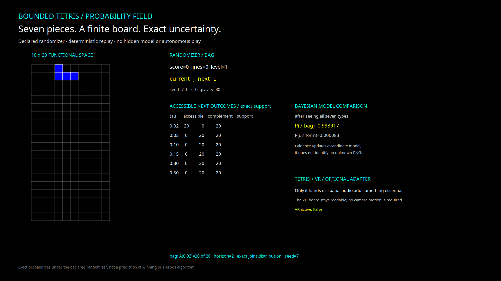

# ZVA-0249 — Bounded Tetris

[Visual archive index](../../README.md) · [Full catalog](../README.md) · [Category: Research figures and measurements](../categories/research-figure.md)

## What this image shows

The bounded Tetris probability-field scene, pairing the game board with exact randomizer and accessible-outcome measurements. This figure preserves a measurement, model output, simulation, geometric construction, or research explanation from the Zoe/allgems program.

## Role in Zoe

This figure preserves a measurement, model output, simulation, geometric construction, or research explanation from the Zoe/allgems program.

## Provenance and evidence boundary

**Provenance:** Zoe/allgems project-generated visual.

The image is preserved with its source context; the visual alone does not prove a scientific or operational claim.

## File identity

- Archive ID: **ZVA-0249**
- Visual family: **bounded-tetris**
- Dimensions/format: **1920×1080 PNG**
- Frames: **1**
- Bytes: **92,518**
- SHA-256: `e3d52ef45eef42cff45e927d1908fc53e8b9f20b5145c64ab2193f93614c92f5`
- Original file: [Open full resolution](../../images/ZVA-0249.png)

## Source occurrences

Byte-identical copies are archived once while every known source path remains recorded.

| Source repository/collection | Original path | Canonical link |
|---|---|---|
| zoe | `components/graphics-environment-manager/docs/images/bounded-tetris.png` | [Source](https://github.com/Ablation-Tool/zoe/blob/main/components/graphics-environment-manager/docs/images/bounded-tetris.png) |

## Documented context

### Install the numerical runtime for mirrored forecasts.

Source document: `zoe:components/graphics-environment-manager/README.md`

Bounded Tetris

Bounded Tetris: exact uncertainty and black-box experiments

## Related format/size variants

- [ZVA-0250](ZVA-0250.md)
