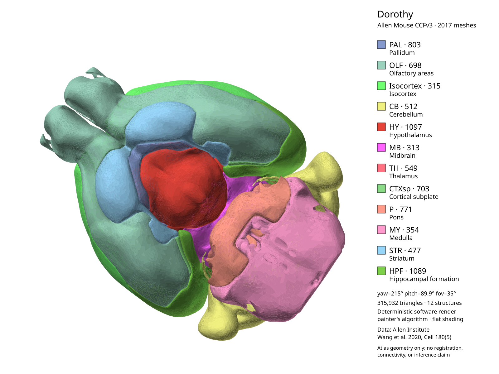

# ZVA-0257 — Dorothy Ventral

[Visual archive index](../../README.md) · [Full catalog](../README.md) · [Category: Research figures and measurements](../categories/research-figure.md)

## What this image shows

A ventral orientation of Dorothy’s Allen Mouse CCFv3 reference geometry, complementing the dorsal and default camera views. This visual belongs to Dorothy’s inspectable spatial-research program, making reference geometry or a review instrument available for direct inspection.

## Role in Zoe

This visual belongs to Dorothy’s inspectable spatial-research program, making reference geometry or a review instrument available for direct inspection.

## Provenance and evidence boundary

**Provenance:** Zoe render using Allen Institute reference data.

Preclinical mouse-atlas geometry only; not patient anatomy, registration, diagnosis, or treatment evidence.

## File identity

- Archive ID: **ZVA-0257**
- Visual family: **dorothy-ventral**
- Dimensions/format: **1600×1200 PNG**
- Frames: **1**
- Bytes: **1,052,505**
- SHA-256: `5d8747d8b4404eb1c8f23ee8e7f1905d0126ee8c63e1d68e4fe390ccceed2f8d`
- Original file: [Open full resolution](../../images/ZVA-0257.png)

## Source occurrences

Byte-identical copies are archived once while every known source path remains recorded.

| Source repository/collection | Original path | Canonical link |
|---|---|---|
| zoe | `components/graphics-environment-manager/docs/images/dorothy-ventral.png` | [Source](https://github.com/Ablation-Tool/zoe/blob/main/components/graphics-environment-manager/docs/images/dorothy-ventral.png) |
| zoe | `guiai-lab/docs/images/dorothy-ventral.png` | [Source](https://github.com/Ablation-Tool/zoe/blob/main/guiai-lab/docs/images/dorothy-ventral.png) |

## Documented context

### 6. Dorothy ventral

Source document: `zoe:research/papers/galleries/zoe-dorothy/README.md`

Dorothy and Neurogarden — Visual research index: Dorothy ventral

`assets/native/dorothy-ventral.png`

### 8. Dorothy ventral

Source document: `zoe:research/papers/galleries/zoe-research/README.md`

Complete Zoe research asset index: Dorothy ventral

`assets/dorothy/dorothy-ventral.png`
