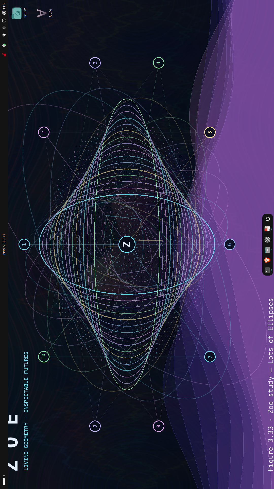

# ZVA-0260 — Zoe Ellipses Mobile

[Visual archive index](../../README.md) · [Full catalog](../README.md) · [Category: Research figures and measurements](../categories/research-figure.md)

## What this image shows

Zoe Ellipses Mobile is a research figures and measurements asset from the graphics-environment-manager portion of the Zoe/allgems project. This figure preserves a measurement, model output, simulation, geometric construction, or research explanation from the Zoe/allgems program.

## Role in Zoe

This figure preserves a measurement, model output, simulation, geometric construction, or research explanation from the Zoe/allgems program.

## Provenance and evidence boundary

**Provenance:** Zoe/allgems project-generated visual.

The image is preserved with its source context; the visual alone does not prove a scientific or operational claim.

## File identity

- Archive ID: **ZVA-0260**
- Visual family: **zoe-ellipses-mobile**
- Dimensions/format: **1080×1920 PNG**
- Frames: **1**
- Bytes: **1,596,431**
- SHA-256: `fc00e82215770daf68a798c3c87da7a7a42a1a2af5dc5c116c11982390691588`
- Original file: [Open full resolution](../../images/ZVA-0260.png)

## Source occurrences

Byte-identical copies are archived once while every known source path remains recorded.

| Source repository/collection | Original path | Canonical link |
|---|---|---|
| zoe | `components/graphics-environment-manager/docs/images/inspiration/zoe-ellipses-mobile.png` | [Source](https://github.com/Ablation-Tool/zoe/blob/main/components/graphics-environment-manager/docs/images/inspiration/zoe-ellipses-mobile.png) |
