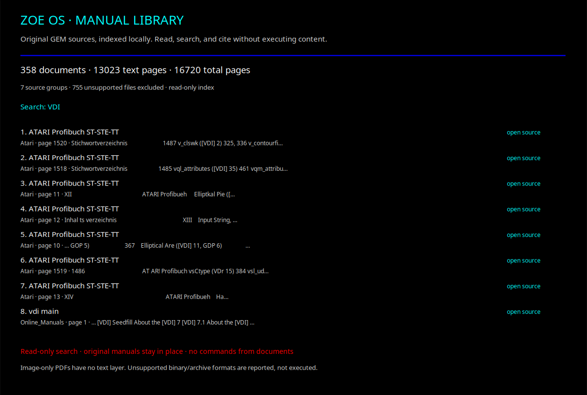

# ZVA-0269 — Zoe Library

[Visual archive index](../../README.md) · [Full catalog](../README.md) · [Category: Research figures and measurements](../categories/research-figure.md)

## What this image shows

Zoe OS manual library. This figure preserves a measurement, model output, simulation, geometric construction, or research explanation from the Zoe/allgems program.

## Role in Zoe

This figure preserves a measurement, model output, simulation, geometric construction, or research explanation from the Zoe/allgems program.

## Provenance and evidence boundary

**Provenance:** Zoe/allgems project-generated visual.

The image is preserved with its source context; the visual alone does not prove a scientific or operational claim.

## File identity

- Archive ID: **ZVA-0269**
- Visual family: **zoe-library**
- Dimensions/format: **1200×807 PNG**
- Frames: **1**
- Bytes: **96,254**
- SHA-256: `75197fff40463bb7cb3ad2ef8a671dffef8d9738b2626d7f103a2755c9567def`
- Original file: [Open full resolution](../../images/ZVA-0269.png)

## Source occurrences

Byte-identical copies are archived once while every known source path remains recorded.

| Source repository/collection | Original path | Canonical link |
|---|---|---|
| zoe | `components/graphics-environment-manager/docs/images/zoe-library.png` | [Source](https://github.com/Ablation-Tool/zoe/blob/main/components/graphics-environment-manager/docs/images/zoe-library.png) |

## Documented context

### Zoe OS manual library

Source document: `zoe:components/graphics-environment-manager/docs/LIBRARY.md`

Zoe OS manual library

The manual library is a **local, read-only search service** inside Zoe OS. It indexes source documents into a new SQLite file, preserves each source's SHA-256 hash, and returns document titles, source groups, page numbers, and snippets. Original manuals are not modified or copied into the repository.

## Related format/size variants

- [ZVA-0270](ZVA-0270.md)
