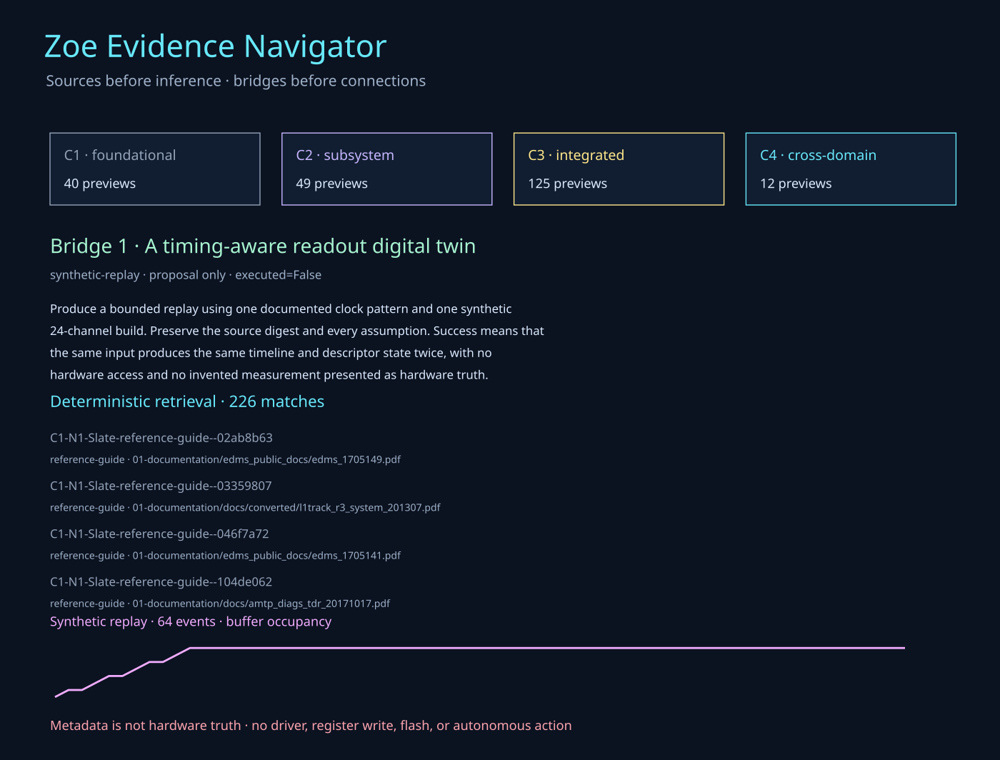

# ZVA-0270 — Zoe Library

[Visual archive index](../../README.md) · [Full catalog](../README.md) · [Category: Research figures and measurements](../categories/research-figure.md)

## What this image shows

Zoe Library is a research figures and measurements asset from the graphics-environment-manager portion of the Zoe/allgems project. This figure preserves a measurement, model output, simulation, geometric construction, or research explanation from the Zoe/allgems program.

## Role in Zoe

This figure preserves a measurement, model output, simulation, geometric construction, or research explanation from the Zoe/allgems program.

## Provenance and evidence boundary

**Provenance:** Zoe/allgems project-generated visual.

The image is preserved with its source context; the visual alone does not prove a scientific or operational claim.

## File identity

- Archive ID: **ZVA-0270**
- Visual family: **zoe-library**
- Dimensions/format: **SVG 1200×807**
- Frames: **vector/not applicable**
- Bytes: **7,538**
- SHA-256: `9f8e0072550777c734b6673523d253ee4b6b3b41d35fbfe0f333d40e64f381cb`
- Original file: [Open full resolution](../../images/ZVA-0270.svg)

## Source occurrences

Byte-identical copies are archived once while every known source path remains recorded.

| Source repository/collection | Original path | Canonical link |
|---|---|---|
| zoe | `components/graphics-environment-manager/docs/images/zoe-library.svg` | [Source](https://github.com/Ablation-Tool/zoe/blob/main/components/graphics-environment-manager/docs/images/zoe-library.svg) |

## Related format/size variants

- [ZVA-0269](ZVA-0269.md)
