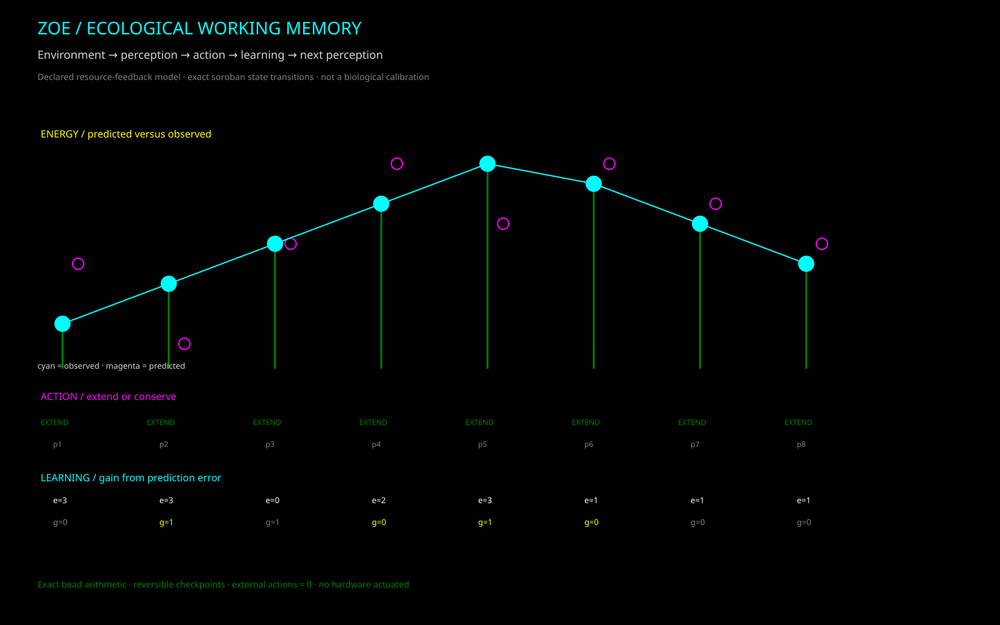

# ZVA-0274 — Ecology

[Visual archive index](../../README.md) · [Full catalog](../README.md) · [Category: Research figures and measurements](../categories/research-figure.md)

## What this image shows

Ecology is a research figures and measurements asset from the graphics-environment-manager portion of the Zoe/allgems project. This figure preserves a measurement, model output, simulation, geometric construction, or research explanation from the Zoe/allgems program.

## Role in Zoe

This figure preserves a measurement, model output, simulation, geometric construction, or research explanation from the Zoe/allgems program.

## Provenance and evidence boundary

**Provenance:** Zoe/allgems project-generated visual.

The image is preserved with its source context; the visual alone does not prove a scientific or operational claim.

## File identity

- Archive ID: **ZVA-0274**
- Visual family: **ecology**
- Dimensions/format: **SVG 1600×1000**
- Frames: **vector/not applicable**
- Bytes: **13,151**
- SHA-256: `264dfef28c8c30f70925d97816e882b89511e48e33d065b19b169aa1d6fb28f3`
- Original file: [Open full resolution](../../images/ZVA-0274.svg)

## Source occurrences

Byte-identical copies are archived once while every known source path remains recorded.

| Source repository/collection | Original path | Canonical link |
|---|---|---|
| zoe | `components/graphics-environment-manager/evidence/abacus/ecology.svg` | [Source](https://github.com/Ablation-Tool/zoe/blob/main/components/graphics-environment-manager/evidence/abacus/ecology.svg) |

## Related format/size variants

- [ZVA-0273](ZVA-0273.md)
