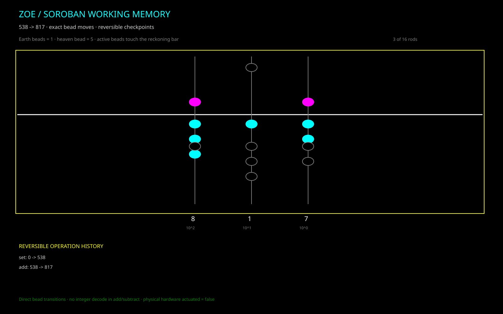

# ZVA-0276 — Soroban

[Visual archive index](../../README.md) · [Full catalog](../README.md) · [Category: Research figures and measurements](../categories/research-figure.md)

## What this image shows

Soroban is a research figures and measurements asset from the graphics-environment-manager portion of the Zoe/allgems project. This figure preserves a measurement, model output, simulation, geometric construction, or research explanation from the Zoe/allgems program.

## Role in Zoe

This figure preserves a measurement, model output, simulation, geometric construction, or research explanation from the Zoe/allgems program.

## Provenance and evidence boundary

**Provenance:** Zoe/allgems project-generated visual.

The image is preserved with its source context; the visual alone does not prove a scientific or operational claim.

## File identity

- Archive ID: **ZVA-0276**
- Visual family: **soroban**
- Dimensions/format: **SVG 1600×1000**
- Frames: **vector/not applicable**
- Bytes: **6,682**
- SHA-256: `13b66875c066d71bb44a7b652a48f05bda77ebbf4e37b8fef6158afb5288e591`
- Original file: [Open full resolution](../../images/ZVA-0276.svg)

## Source occurrences

Byte-identical copies are archived once while every known source path remains recorded.

| Source repository/collection | Original path | Canonical link |
|---|---|---|
| zoe | `components/graphics-environment-manager/evidence/abacus/soroban.svg` | [Source](https://github.com/Ablation-Tool/zoe/blob/main/components/graphics-environment-manager/evidence/abacus/soroban.svg) |

## Related format/size variants

- [ZVA-0275](ZVA-0275.md)
