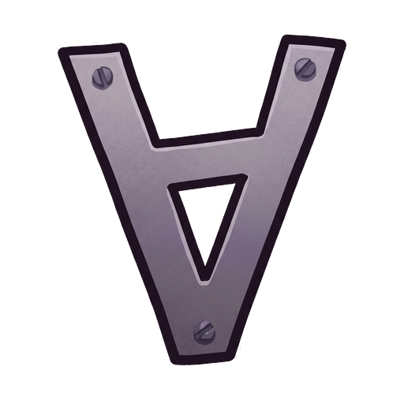

# ZVA-0281 — Ablation GEM Logo

[Visual archive index](../../README.md) · [Full catalog](../README.md) · [Category: Identity, emblems, and interface icons](../categories/branding.md)

## What this image shows

The stylized Ablation GEM project mark, used as a compact identity asset rather than a research figure. This visual supports recognition, navigation, application identity, or a cohesive visual language across Zoe and its components.

## Role in Zoe

This visual supports recognition, navigation, application identity, or a cohesive visual language across Zoe and its components.

## Provenance and evidence boundary

**Provenance:** Project identity or interface asset.

Functional and identity artwork does not constitute research evidence.

## File identity

- Archive ID: **ZVA-0281**
- Visual family: **ablation-gem-logo**
- Dimensions/format: **512×512 PNG**
- Frames: **1**
- Bytes: **183,874**
- SHA-256: `e65c842c4504b74b11be37d5f421717cd754193d9a85770340455bf55539fbad`
- Original file: [Open full resolution](../../images/ZVA-0281.png)

## Source occurrences

Byte-identical copies are archived once while every known source path remains recorded.

| Source repository/collection | Original path | Canonical link |
|---|---|---|
| zoe | `components/graphics-environment-manager/gem/icons/ablation-gem-logo.png` | [Source](https://github.com/Ablation-Tool/zoe/blob/main/components/graphics-environment-manager/gem/icons/ablation-gem-logo.png) |
| zoe | `guiai-lab/build/lib/guiai/icons/ablation-guiai-logo.png` | [Source](https://github.com/Ablation-Tool/zoe/blob/main/guiai-lab/build/lib/guiai/icons/ablation-guiai-logo.png) |
| zoe | `guiai-lab/guiai/icons/ablation-guiai-logo.png` | [Source](https://github.com/Ablation-Tool/zoe/blob/main/guiai-lab/guiai/icons/ablation-guiai-logo.png) |
