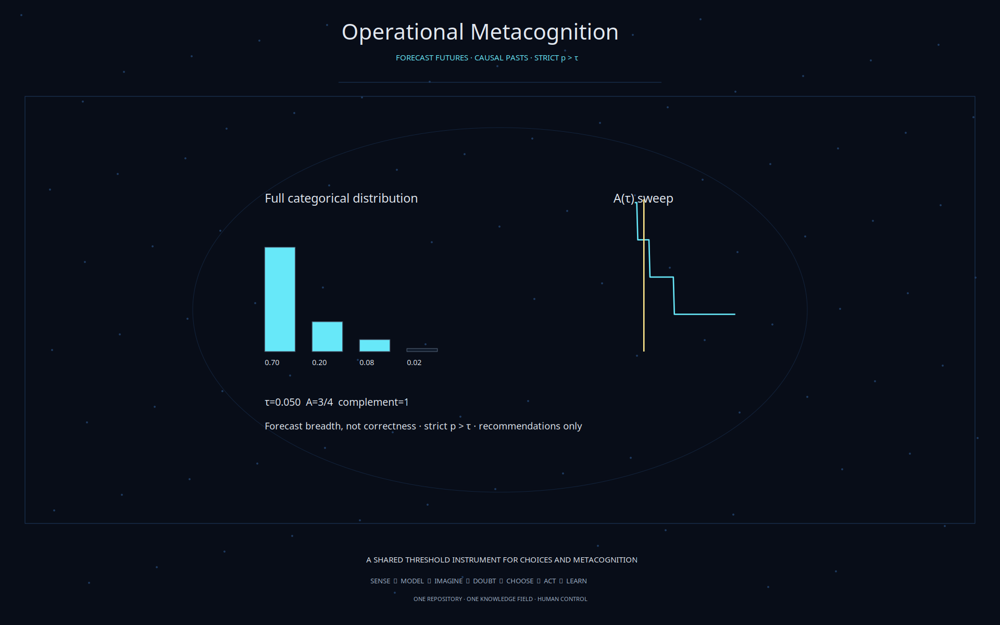

# ZVA-0285 — Accessible Volume Hero

[Visual archive index](../../README.md) · [Full catalog](../README.md) · [Category: Research figures and measurements](../categories/research-figure.md)

## What this image shows

A visual introduction to operational metacognition as a shared threshold instrument for forecast futures and explicitly modeled causal pasts. This figure preserves a measurement, model output, simulation, geometric construction, or research explanation from the Zoe/allgems program.

## Role in Zoe

This figure preserves a measurement, model output, simulation, geometric construction, or research explanation from the Zoe/allgems program.

## Provenance and evidence boundary

**Provenance:** Zoe/allgems project-generated visual.

The image is preserved with its source context; the visual alone does not prove a scientific or operational claim.

## File identity

- Archive ID: **ZVA-0285**
- Visual family: **accessible-volume-hero**
- Dimensions/format: **1920×1200 PNG**
- Frames: **1**
- Bytes: **82,094**
- SHA-256: `3bfe125c257c1c0499598953310832679eae25e7359319aba899c8797a9de8e5`
- Original file: [Open full resolution](../../images/ZVA-0285.png)

## Source occurrences

Byte-identical copies are archived once while every known source path remains recorded.

| Source repository/collection | Original path | Canonical link |
|---|---|---|
| zoe | `components/next-token-predictability/assets/accessible-volume-hero.png` | [Source](https://github.com/Ablation-Tool/zoe/blob/main/components/next-token-predictability/assets/accessible-volume-hero.png) |
| next-token | `assets/accessible-volume-hero.png` | [Source](https://github.com/Ablation-Tool/next-token-predictability/blob/main/assets/accessible-volume-hero.png) |

## Related format/size variants

- [ZVA-0286](ZVA-0286.md)
