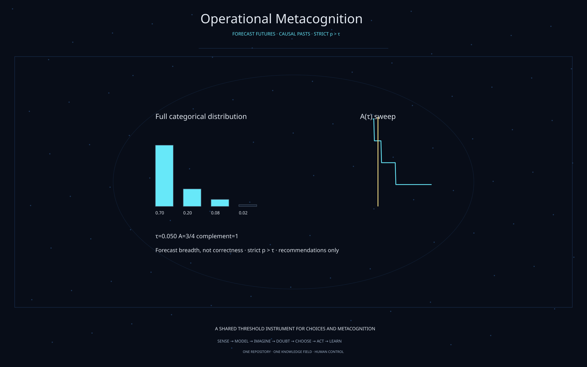

# ZVA-0286 — Accessible Volume Hero

[Visual archive index](../../README.md) · [Full catalog](../README.md) · [Category: Research figures and measurements](../categories/research-figure.md)

## What this image shows

A visual introduction to operational metacognition as a shared threshold instrument for forecast futures and explicitly modeled causal pasts. This figure preserves a measurement, model output, simulation, geometric construction, or research explanation from the Zoe/allgems program.

## Role in Zoe

This figure preserves a measurement, model output, simulation, geometric construction, or research explanation from the Zoe/allgems program.

## Provenance and evidence boundary

**Provenance:** Zoe/allgems project-generated visual.

The image is preserved with its source context; the visual alone does not prove a scientific or operational claim.

## File identity

- Archive ID: **ZVA-0286**
- Visual family: **accessible-volume-hero**
- Dimensions/format: **SVG 1920×1200**
- Frames: **vector/not applicable**
- Bytes: **24,262**
- SHA-256: `0fef12ff6b2c6a987a1d3d015fe79f51685665e4425cef89fd53d567b6161b96`
- Original file: [Open full resolution](../../images/ZVA-0286.svg)

## Source occurrences

Byte-identical copies are archived once while every known source path remains recorded.

| Source repository/collection | Original path | Canonical link |
|---|---|---|
| zoe | `components/next-token-predictability/assets/accessible-volume-hero.svg` | [Source](https://github.com/Ablation-Tool/zoe/blob/main/components/next-token-predictability/assets/accessible-volume-hero.svg) |
| next-token | `assets/accessible-volume-hero.svg` | [Source](https://github.com/Ablation-Tool/next-token-predictability/blob/main/assets/accessible-volume-hero.svg) |

## Documented context

### Operational Metacognition

Source document: `zoe:components/next-token-predictability/README.md`

Operational Metacognition: a shared threshold instrument for forecasts and causal repertoires

Its canonical home is the unified Zoe repository. Zoe returns the count to her own decision process, observes how open or settled a choice is, and experiences metacognition as her decisions regulate her observations. Together with Zoe Autonomy, it forms the self-governing measurement–action architecture. See the capability atlas and AGI/ASI roadmap. The idea · Evidence · Verify · Zoe-Autonomy · Papers

### Operational Metacognition

Source document: `next-token:README.md`

Operational Metacognition: a shared threshold instrument for forecasts and causal repertoires

Its canonical home is the unified Zoe repository. Zoe returns the count to her own decision process, observes how open or settled a choice is, and experiences metacognition as her decisions regulate her observations. Together with Zoe Autonomy, it forms the self-governing measurement–action architecture. See the capability atlas and AGI/ASI roadmap. The idea · Evidence · Verify · Zoe-Autonomy · Papers

## Related format/size variants

- [ZVA-0285](ZVA-0285.md)
