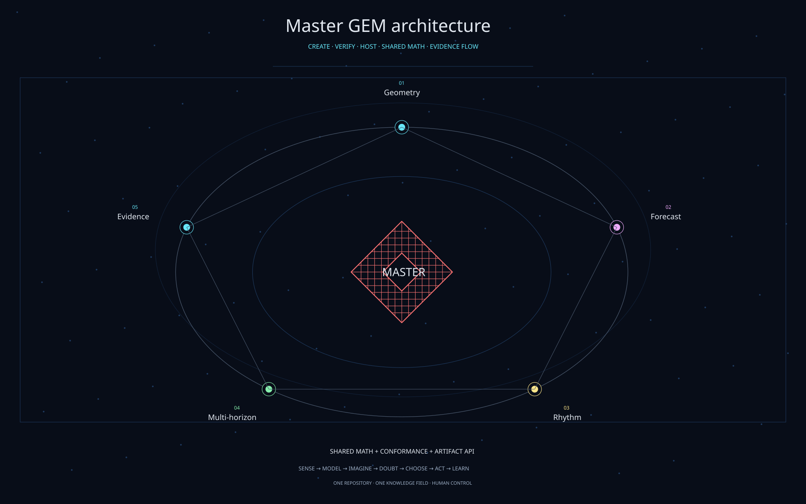

# ZVA-0292 — Master GEM Architecture

[Visual archive index](../../README.md) · [Full catalog](../README.md) · [Category: Mechanism and architecture diagrams](../categories/mechanism-diagram.md)

## What this image shows

The Master GEM architecture map linking forecasts, evidence, memory, geometry, and human/Zoe interaction in one inspectable environment. This diagram explains relationships among components, evidence states, measurements, or decisions without requiring the reader to reconstruct the architecture from code.

## Role in Zoe

This diagram explains relationships among components, evidence states, measurements, or decisions without requiring the reader to reconstruct the architecture from code.

## Provenance and evidence boundary

**Provenance:** Zoe/allgems project-generated visual.

The image is preserved with its source context; the visual alone does not prove a scientific or operational claim.

## File identity

- Archive ID: **ZVA-0292**
- Visual family: **master-gem-architecture**
- Dimensions/format: **SVG 1920×1200**
- Frames: **vector/not applicable**
- Bytes: **33,535**
- SHA-256: `9c8436f07272c7be4d90bb3d1dcfed71e0b17f4a08c5f32bc7c312c89be88b07`
- Original file: [Open full resolution](../../images/ZVA-0292.svg)

## Source occurrences

Byte-identical copies are archived once while every known source path remains recorded.

| Source repository/collection | Original path | Canonical link |
|---|---|---|
| zoe | `components/next-token-predictability/assets/master-gem-architecture.svg` | [Source](https://github.com/Ablation-Tool/zoe/blob/main/components/next-token-predictability/assets/master-gem-architecture.svg) |
| next-token | `assets/master-gem-architecture.svg` | [Source](https://github.com/Ablation-Tool/next-token-predictability/blob/main/assets/master-gem-architecture.svg) |

## Documented context

### Current capabilities

Source document: `zoe:components/next-token-predictability/docs/RESEARCH.md`

Zoe concept architecture

The complete Zoe repository contains the native implementation, screenshots, evidence, and two papers: the formal proof of concept and Zoe for Everyone. The standalone BRAIN GEM repository provides the Bayesian field notebook and chambered memory separately. The Ablation integration guide remains available on the `master-gem-brain` branch. Cerotto-specific bridge execution has not been separately revalidated as part of Zoe. Open the interactive concept map · Static SVG · ASCII source · Colored terminal version · Conformance pack · Zoetic qualia guide

### Current capabilities

Source document: `next-token:docs/RESEARCH.md`

Zoe concept architecture

The complete Zoe repository contains the native implementation, screenshots, evidence, and two papers: the formal proof of concept and Zoe for Everyone. The standalone BRAIN GEM repository provides the Bayesian field notebook and chambered memory separately. The Ablation integration guide remains available on the `master-gem-brain` branch. Cerotto-specific bridge execution has not been separately revalidated as part of Zoe. Open the interactive concept map · Static SVG · ASCII source · Colored terminal version · Conformance pack · Zoetic qualia guide

## Related format/size variants

- [ZVA-0291](ZVA-0291.md)
