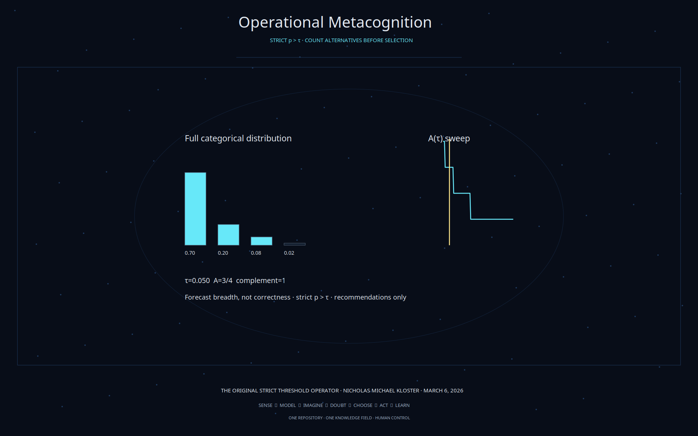

# ZVA-0294 — Next Token Probability Equation

[Visual archive index](../../README.md) · [Full catalog](../README.md) · [Category: Research figures and measurements](../categories/research-figure.md)

## What this image shows

A visual statement of the original strict next-token accessible-volume equation and its above-threshold alternatives. This figure preserves a measurement, model output, simulation, geometric construction, or research explanation from the Zoe/allgems program.

## Role in Zoe

This figure preserves a measurement, model output, simulation, geometric construction, or research explanation from the Zoe/allgems program.

## Provenance and evidence boundary

**Provenance:** Zoe/allgems project-generated visual.

The image is preserved with its source context; the visual alone does not prove a scientific or operational claim.

## File identity

- Archive ID: **ZVA-0294**
- Visual family: **next-token-probability-equation**
- Dimensions/format: **1920×1200 PNG**
- Frames: **1**
- Bytes: **83,909**
- SHA-256: `0e8a252fadf452e228ea776ea07796c30fe4cc24dec140687315f0d99c78160d`
- Original file: [Open full resolution](../../images/ZVA-0294.png)

## Source occurrences

Byte-identical copies are archived once while every known source path remains recorded.

| Source repository/collection | Original path | Canonical link |
|---|---|---|
| zoe | `components/next-token-predictability/assets/next-token-probability-equation.png` | [Source](https://github.com/Ablation-Tool/zoe/blob/main/components/next-token-predictability/assets/next-token-probability-equation.png) |
| next-token | `assets/next-token-probability-equation.png` | [Source](https://github.com/Ablation-Tool/next-token-predictability/blob/main/assets/next-token-probability-equation.png) |

## Documented context

### The Significance of Operational Metacognition

Source document: `zoe:components/next-token-predictability/docs/RESEARCH.md`

Next-token probability and the accessible-volume equation

### The Significance of Operational Metacognition

Source document: `next-token:docs/RESEARCH.md`

Next-token probability and the accessible-volume equation

## Related format/size variants

- [ZVA-0295](ZVA-0295.md)
