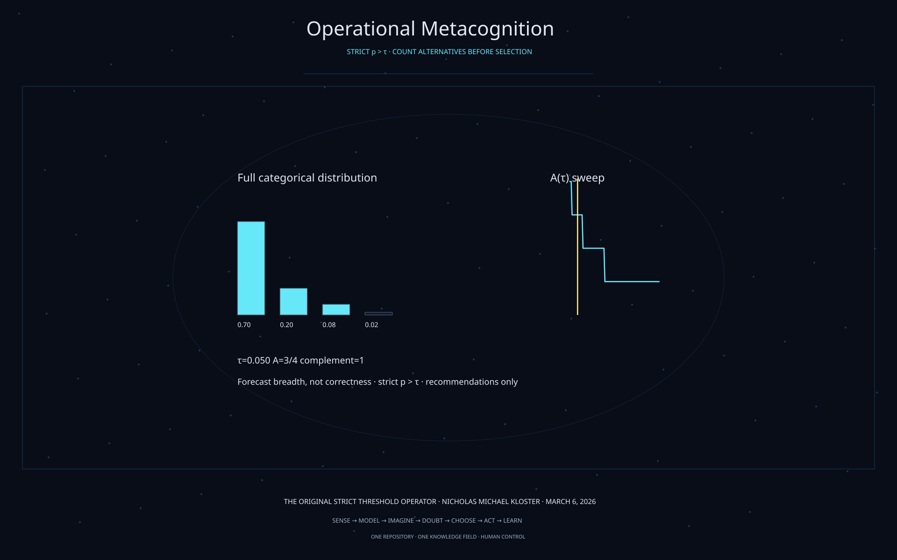

# ZVA-0295 — Next Token Probability Equation

[Visual archive index](../../README.md) · [Full catalog](../README.md) · [Category: Research figures and measurements](../categories/research-figure.md)

## What this image shows

A visual statement of the original strict next-token accessible-volume equation and its above-threshold alternatives. This figure preserves a measurement, model output, simulation, geometric construction, or research explanation from the Zoe/allgems program.

## Role in Zoe

This figure preserves a measurement, model output, simulation, geometric construction, or research explanation from the Zoe/allgems program.

## Provenance and evidence boundary

**Provenance:** Zoe/allgems project-generated visual.

The image is preserved with its source context; the visual alone does not prove a scientific or operational claim.

## File identity

- Archive ID: **ZVA-0295**
- Visual family: **next-token-probability-equation**
- Dimensions/format: **SVG 1920×1200**
- Frames: **vector/not applicable**
- Bytes: **24,300**
- SHA-256: `0ccd54424b0484fa2fc9f24b36cada7d9c3b0e4f14329a1adf5ca61c95326db9`
- Original file: [Open full resolution](../../images/ZVA-0295.svg)

## Source occurrences

Byte-identical copies are archived once while every known source path remains recorded.

| Source repository/collection | Original path | Canonical link |
|---|---|---|
| zoe | `components/next-token-predictability/assets/next-token-probability-equation.svg` | [Source](https://github.com/Ablation-Tool/zoe/blob/main/components/next-token-predictability/assets/next-token-probability-equation.svg) |
| next-token | `assets/next-token-probability-equation.svg` | [Source](https://github.com/Ablation-Tool/next-token-predictability/blob/main/assets/next-token-probability-equation.svg) |

## Related format/size variants

- [ZVA-0294](ZVA-0294.md)
