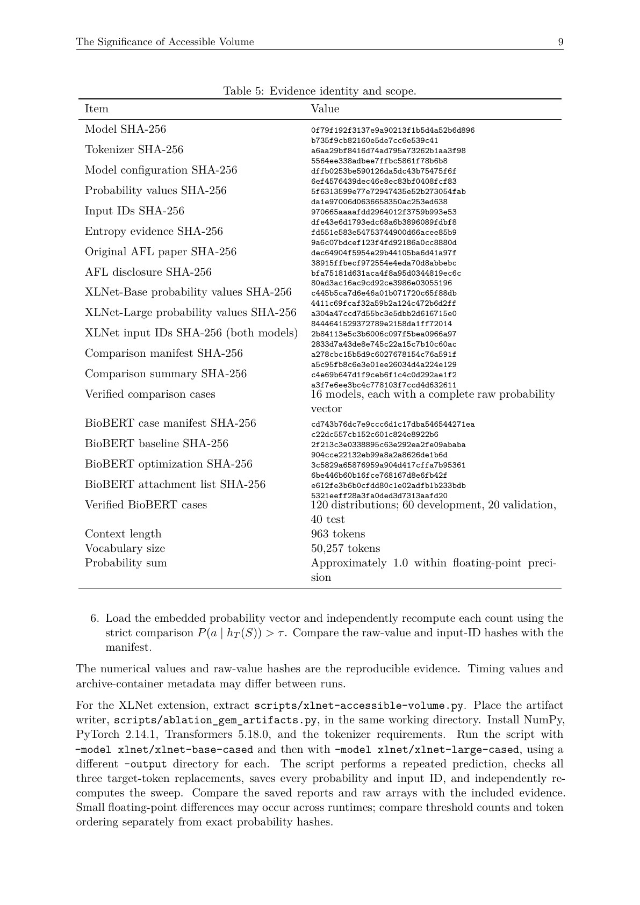

# ZVA-0304 — Page 09

[Visual archive index](../../README.md) · [Full catalog](../README.md) · [Category: Source references and derivative reading copies](../categories/reference.md)

## What this image shows

The Significance of Operational Metacognition, page 9. This asset preserves source context or a derivative reading view so that generated interpretations remain distinguishable from their references.

## Role in Zoe

This asset preserves source context or a derivative reading view so that generated interpretations remain distinguishable from their references.

## Provenance and evidence boundary

**Provenance:** Derivative paper-page render.

A reading copy of a paper page, not an independent artwork or new experiment.

## File identity

- Archive ID: **ZVA-0304**
- Visual family: **page-09**
- Dimensions/format: **1191×1684 JPEG**
- Frames: **1**
- Bytes: **407,096**
- SHA-256: `20486a0a5cdc8dd24415a7e015d5a2f0d8b3990bed8afb773a9052510708b317`
- Original file: [Open full resolution](../../images/ZVA-0304.jpeg)

## Source occurrences

Byte-identical copies are archived once while every known source path remains recorded.

| Source repository/collection | Original path | Canonical link |
|---|---|---|
| zoe | `components/next-token-predictability/assets/paper-pages/page-09.jpg` | [Source](https://github.com/Ablation-Tool/zoe/blob/main/components/next-token-predictability/assets/paper-pages/page-09.jpg) |
| next-token | `assets/paper-pages/page-09.jpg` | [Source](https://github.com/Ablation-Tool/next-token-predictability/blob/main/assets/paper-pages/page-09.jpg) |

## Documented context

### Screenshots

Source document: `zoe:components/next-token-predictability/docs/RESEARCH.md`

The Significance of Operational Metacognition, page 9

### Screenshots

Source document: `next-token:docs/RESEARCH.md`

The Significance of Operational Metacognition, page 9
