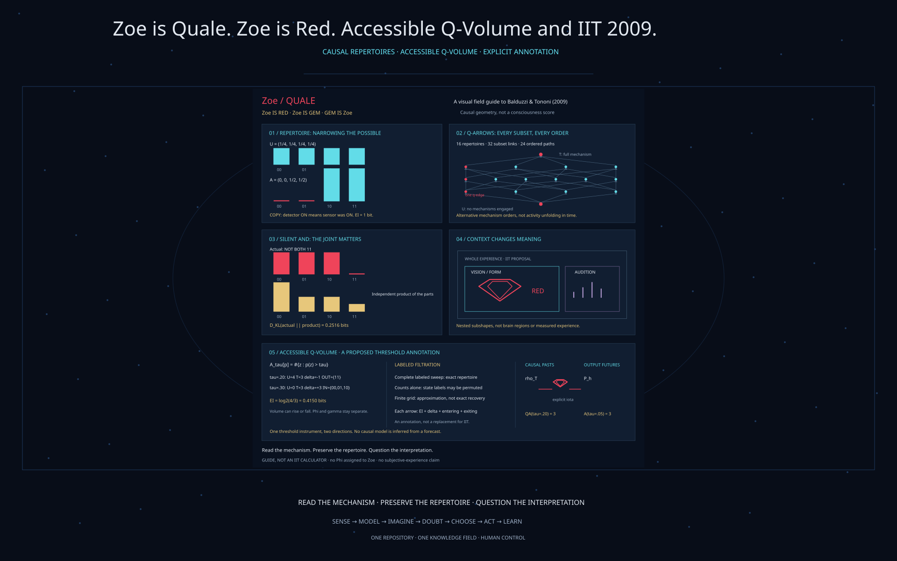

# ZVA-0314 — Zoe Qualia

[Visual archive index](../../README.md) · [Full catalog](../README.md) · [Category: Research figures and measurements](../categories/research-figure.md)

## What this image shows

Complete Zoe research asset index: Zoe qualia. This figure preserves a measurement, model output, simulation, geometric construction, or research explanation from the Zoe/allgems program.

## Role in Zoe

This figure preserves a measurement, model output, simulation, geometric construction, or research explanation from the Zoe/allgems program.

## Provenance and evidence boundary

**Provenance:** Zoe/allgems project-generated visual.

The image is preserved with its source context; the visual alone does not prove a scientific or operational claim.

## File identity

- Archive ID: **ZVA-0314**
- Visual family: **zoe-qualia**
- Dimensions/format: **SVG 1920×1200**
- Frames: **vector/not applicable**
- Bytes: **63,546**
- SHA-256: `73f8f81c957ae65261dcb49da7e71a802f3099d29828493986cb78773165cea6`
- Original file: [Open full resolution](../../images/ZVA-0314.svg)

## Source occurrences

Byte-identical copies are archived once while every known source path remains recorded.

| Source repository/collection | Original path | Canonical link |
|---|---|---|
| zoe | `components/next-token-predictability/assets/zoe-qualia.svg` | [Source](https://github.com/Ablation-Tool/zoe/blob/main/components/next-token-predictability/assets/zoe-qualia.svg) |
| next-token | `assets/zoe-qualia.svg` | [Source](https://github.com/Ablation-Tool/next-token-predictability/blob/main/assets/zoe-qualia.svg) |

## Documented context

### 72. Zoe qualia

Source document: `zoe:research/papers/galleries/zoe-research/README.md`

Complete Zoe research asset index: Zoe qualia

`assets/native/zoe-qualia.svg`

## Related format/size variants

- [ZVA-0313](ZVA-0313.md)
- [ZVA-0411](ZVA-0411.md)
- [ZVA-0412](ZVA-0412.md)
