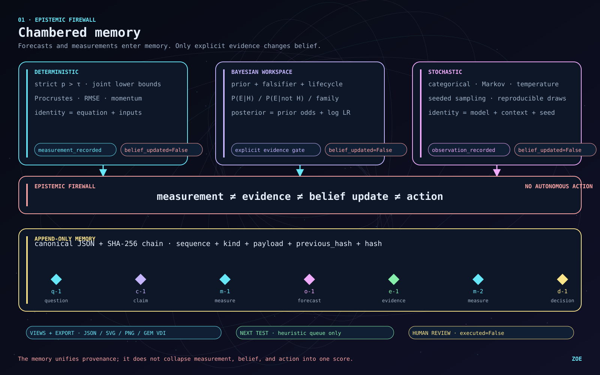

# ZVA-0316 — 01 Epistemic Firewall

[Visual archive index](../../README.md) · [Full catalog](../README.md) · [Category: Mechanism and architecture diagrams](../categories/mechanism-diagram.md)

## What this image shows

Zoe epistemic firewall. This diagram explains relationships among components, evidence states, measurements, or decisions without requiring the reader to reconstruct the architecture from code.

## Role in Zoe

This diagram explains relationships among components, evidence states, measurements, or decisions without requiring the reader to reconstruct the architecture from code.

## Provenance and evidence boundary

**Provenance:** Zoe/allgems project-generated visual.

The image is preserved with its source context; the visual alone does not prove a scientific or operational claim.

## File identity

- Archive ID: **ZVA-0316**
- Visual family: **01-epistemic-firewall**
- Dimensions/format: **1600×1000 PNG**
- Frames: **1**
- Bytes: **251,867**
- SHA-256: `1e6d9ac8a8afce59d2acf34344a48b2121f0374987cf10f3cc070a65f95acf56`
- Original file: [Open full resolution](../../images/ZVA-0316.png)

## Source occurrences

Byte-identical copies are archived once while every known source path remains recorded.

| Source repository/collection | Original path | Canonical link |
|---|---|---|
| zoe | `components/next-token-predictability/assets/zoe-visuals/01-epistemic-firewall.png` | [Source](https://github.com/Ablation-Tool/zoe/blob/main/components/next-token-predictability/assets/zoe-visuals/01-epistemic-firewall.png) |
| next-token | `assets/zoe-visuals/01-epistemic-firewall.png` | [Source](https://github.com/Ablation-Tool/next-token-predictability/blob/main/assets/zoe-visuals/01-epistemic-firewall.png) |

## Documented context

### Functional modules

Source document: `zoe:research/papers/zoe-research/docs/native/ZOE.md`

Zoe epistemic firewall

Five Zoe mechanisms in pictures 1. **Epistemic firewall:** measurement, evidence, belief updates, and action remain distinct.

### 80. 01 epistemic firewall

Source document: `zoe:research/papers/galleries/zoe-research/README.md`

Complete Zoe research asset index: 01 epistemic firewall

`assets/native/zoe-visuals/01-epistemic-firewall.png`

### Functional modules

Source document: `zoe:guiai-lab/docs/ZOE.md`

Zoe epistemic firewall

Five Zoe mechanisms in pictures 1. **Epistemic firewall:** measurement, evidence, belief updates, and action remain distinct.

### See Zoe in action

Source document: `zoe:components/next-token-predictability/docs/RESEARCH.md`

Zoe epistemic firewall

Five Zoe mechanisms in pictures 1. **Epistemic firewall:** measurement, evidence, belief updates, and action remain distinct.

### See Zoe in action

Source document: `next-token:docs/RESEARCH.md`

Zoe epistemic firewall

Five Zoe mechanisms in pictures 1. **Epistemic firewall:** measurement, evidence, belief updates, and action remain distinct.

## Related format/size variants

- [ZVA-0317](ZVA-0317.md)
- [ZVA-0421](ZVA-0421.md)
