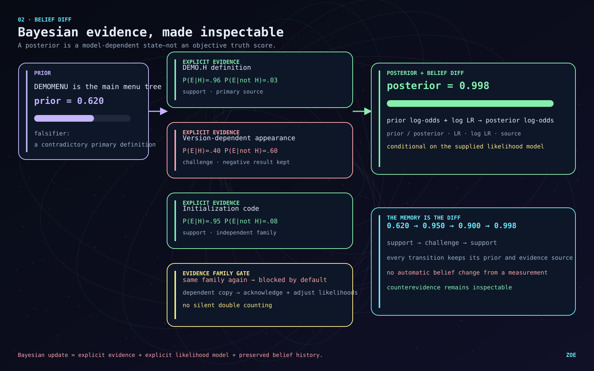

# ZVA-0318 — 02 Belief Diff

[Visual archive index](../../README.md) · [Full catalog](../README.md) · [Category: Mechanism and architecture diagrams](../categories/mechanism-diagram.md)

## What this image shows

Zoe belief diff. This diagram explains relationships among components, evidence states, measurements, or decisions without requiring the reader to reconstruct the architecture from code.

## Role in Zoe

This diagram explains relationships among components, evidence states, measurements, or decisions without requiring the reader to reconstruct the architecture from code.

## Provenance and evidence boundary

**Provenance:** Zoe/allgems project-generated visual.

The image is preserved with its source context; the visual alone does not prove a scientific or operational claim.

## File identity

- Archive ID: **ZVA-0318**
- Visual family: **02-belief-diff**
- Dimensions/format: **1600×1000 PNG**
- Frames: **1**
- Bytes: **299,635**
- SHA-256: `85221e229da3f6e9df2af906475c824b58d56dc83cc80d4cac46b0401fb257b2`
- Original file: [Open full resolution](../../images/ZVA-0318.png)

## Source occurrences

Byte-identical copies are archived once while every known source path remains recorded.

| Source repository/collection | Original path | Canonical link |
|---|---|---|
| zoe | `components/next-token-predictability/assets/zoe-visuals/02-belief-diff.png` | [Source](https://github.com/Ablation-Tool/zoe/blob/main/components/next-token-predictability/assets/zoe-visuals/02-belief-diff.png) |
| next-token | `assets/zoe-visuals/02-belief-diff.png` | [Source](https://github.com/Ablation-Tool/next-token-predictability/blob/main/assets/zoe-visuals/02-belief-diff.png) |

## Documented context

### Functional modules

Source document: `zoe:research/papers/zoe-research/docs/native/ZOE.md`

Zoe belief diff

1. **Epistemic firewall:** measurement, evidence, belief updates, and action remain distinct. SVG 2. **Belief diff:** priors become posteriors only through explicit evidence, with every likelihood and source retained.

### 82. 02 belief diff

Source document: `zoe:research/papers/galleries/zoe-research/README.md`

Complete Zoe research asset index: 02 belief diff

`assets/native/zoe-visuals/02-belief-diff.png`

### Functional modules

Source document: `zoe:guiai-lab/docs/ZOE.md`

Zoe belief diff

1. **Epistemic firewall:** measurement, evidence, belief updates, and action remain distinct. SVG 2. **Belief diff:** priors become posteriors only through explicit evidence, with every likelihood and source retained.

### See Zoe in action

Source document: `zoe:components/next-token-predictability/docs/RESEARCH.md`

Zoe belief diff

1. **Epistemic firewall:** measurement, evidence, belief updates, and action remain distinct. SVG 2. **Belief diff:** priors become posteriors only through explicit evidence, with every likelihood and source retained.

### See Zoe in action

Source document: `next-token:docs/RESEARCH.md`

Zoe belief diff

1. **Epistemic firewall:** measurement, evidence, belief updates, and action remain distinct. SVG 2. **Belief diff:** priors become posteriors only through explicit evidence, with every likelihood and source retained.

## Related format/size variants

- [ZVA-0319](ZVA-0319.md)
- [ZVA-0422](ZVA-0422.md)
- [ZVA-0423](ZVA-0423.md)
