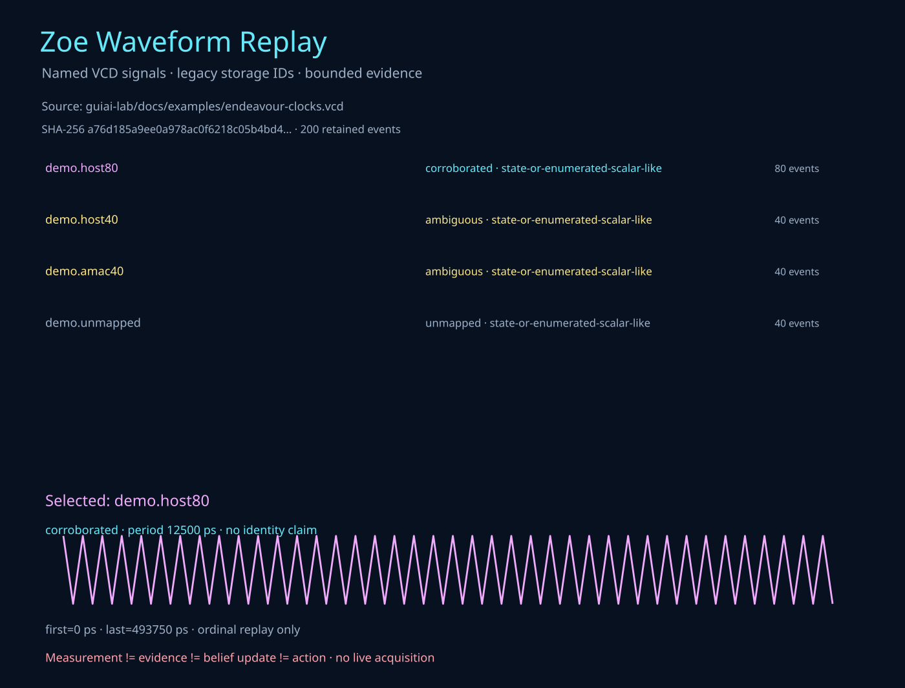

# ZVA-0322 — 04 Memory Chain

[Visual archive index](../../README.md) · [Full catalog](../README.md) · [Category: Mechanism and architecture diagrams](../categories/mechanism-diagram.md)

## What this image shows

Complete Zoe research asset index: 04 memory chain. This diagram explains relationships among components, evidence states, measurements, or decisions without requiring the reader to reconstruct the architecture from code.

## Role in Zoe

This diagram explains relationships among components, evidence states, measurements, or decisions without requiring the reader to reconstruct the architecture from code.

## Provenance and evidence boundary

**Provenance:** Zoe/allgems project-generated visual.

The image is preserved with its source context; the visual alone does not prove a scientific or operational claim.

## File identity

- Archive ID: **ZVA-0322**
- Visual family: **04-memory-chain**
- Dimensions/format: **SVG 1600×1000**
- Frames: **vector/not applicable**
- Bytes: **21,097**
- SHA-256: `2a9ce641ef839899a69dc514f7c45ee152556f9376f82b66fd2a7366f486da03`
- Original file: [Open full resolution](../../images/ZVA-0322.svg)

## Source occurrences

Byte-identical copies are archived once while every known source path remains recorded.

| Source repository/collection | Original path | Canonical link |
|---|---|---|
| zoe | `components/next-token-predictability/assets/zoe-visuals/04-memory-chain.svg` | [Source](https://github.com/Ablation-Tool/zoe/blob/main/components/next-token-predictability/assets/zoe-visuals/04-memory-chain.svg) |
| zoe | `guiai-lab/docs/images/zoe-visuals/04-memory-chain.svg` | [Source](https://github.com/Ablation-Tool/zoe/blob/main/guiai-lab/docs/images/zoe-visuals/04-memory-chain.svg) |
| next-token | `assets/zoe-visuals/04-memory-chain.svg` | [Source](https://github.com/Ablation-Tool/next-token-predictability/blob/main/assets/zoe-visuals/04-memory-chain.svg) |

## Documented context

### 87. 04 memory chain

Source document: `zoe:research/papers/galleries/zoe-research/README.md`

Complete Zoe research asset index: 04 memory chain

`assets/native/zoe-visuals/04-memory-chain.svg`
