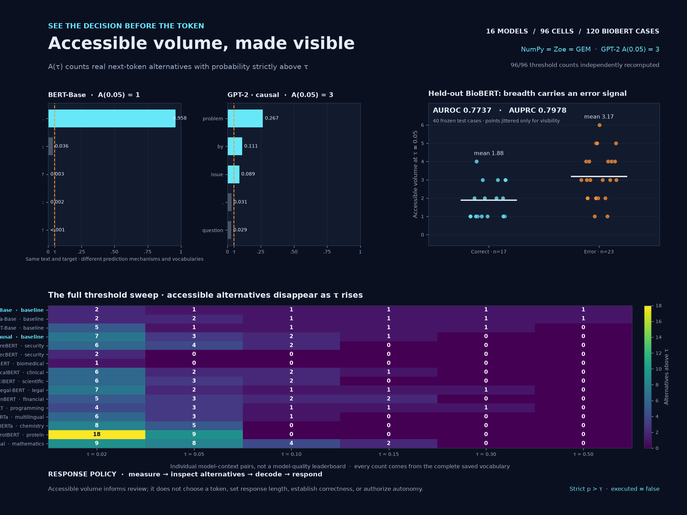

# ZVA-0325 — Response Planning Proof

[Visual archive index](../../README.md) · [Full catalog](../README.md) · [Category: Research figures and measurements](../categories/research-figure.md)

## What this image shows

A multi-panel response-planning evidence dashboard comparing strict full-vocabulary operational metacognition with bounded top-k observations and planning diagnostics. This figure preserves a measurement, model output, simulation, geometric construction, or research explanation from the Zoe/allgems program.

## Role in Zoe

This figure preserves a measurement, model output, simulation, geometric construction, or research explanation from the Zoe/allgems program.

## Provenance and evidence boundary

**Provenance:** Zoe/allgems project-generated visual.

The image is preserved with its source context; the visual alone does not prove a scientific or operational claim.

## File identity

- Archive ID: **ZVA-0325**
- Visual family: **response-planning-proof**
- Dimensions/format: **2000×1500 PNG**
- Frames: **1**
- Bytes: **256,147**
- SHA-256: `202c1e2928b7147fc4059e138243846ae516dae654bc6711e941f2de7244e002`
- Original file: [Open full resolution](../../images/ZVA-0325.png)

## Source occurrences

Byte-identical copies are archived once while every known source path remains recorded.

| Source repository/collection | Original path | Canonical link |
|---|---|---|
| zoe | `components/next-token-predictability/evidence/response-planning/response-planning-proof.png` | [Source](https://github.com/Ablation-Tool/zoe/blob/main/components/next-token-predictability/evidence/response-planning/response-planning-proof.png) |
| next-token | `evidence/response-planning/response-planning-proof.png` | [Source](https://github.com/Ablation-Tool/next-token-predictability/blob/main/evidence/response-planning/response-planning-proof.png) |

## Related format/size variants

- [ZVA-0326](ZVA-0326.md)
