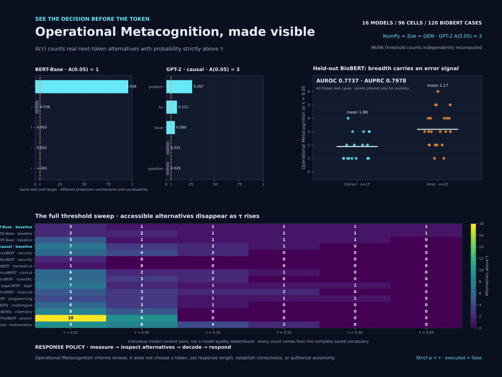

# ZVA-0326 — Response Planning Proof

[Visual archive index](../../README.md) · [Full catalog](../README.md) · [Category: Research figures and measurements](../categories/research-figure.md)

## What this image shows

A multi-panel response-planning evidence dashboard comparing strict full-vocabulary operational metacognition with bounded top-k observations and planning diagnostics. This figure preserves a measurement, model output, simulation, geometric construction, or research explanation from the Zoe/allgems program.

## Role in Zoe

This figure preserves a measurement, model output, simulation, geometric construction, or research explanation from the Zoe/allgems program.

## Provenance and evidence boundary

**Provenance:** Zoe/allgems project-generated visual.

The image is preserved with its source context; the visual alone does not prove a scientific or operational claim.

## File identity

- Archive ID: **ZVA-0326**
- Visual family: **response-planning-proof**
- Dimensions/format: **SVG 1152pt×864pt**
- Frames: **vector/not applicable**
- Bytes: **84,539**
- SHA-256: `649b1241aa3ae77b4ed2dac8b608d8f72829ffa51fb935587b645e461948ad1d`
- Original file: [Open full resolution](../../images/ZVA-0326.svg)

## Source occurrences

Byte-identical copies are archived once while every known source path remains recorded.

| Source repository/collection | Original path | Canonical link |
|---|---|---|
| zoe | `components/next-token-predictability/evidence/response-planning/response-planning-proof.svg` | [Source](https://github.com/Ablation-Tool/zoe/blob/main/components/next-token-predictability/evidence/response-planning/response-planning-proof.svg) |
| next-token | `evidence/response-planning/response-planning-proof.svg` | [Source](https://github.com/Ablation-Tool/next-token-predictability/blob/main/evidence/response-planning/response-planning-proof.svg) |

## Related format/size variants

- [ZVA-0325](ZVA-0325.md)
