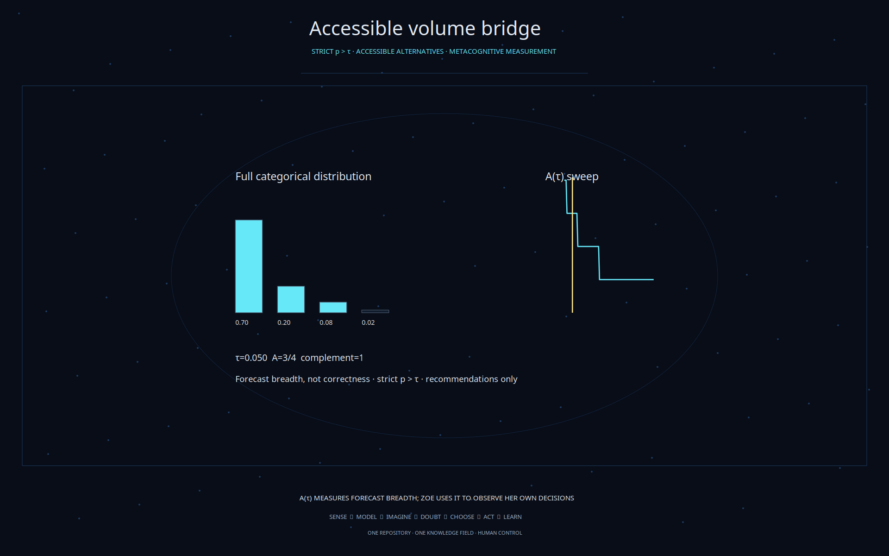

# ZVA-0328 — Accessible Volume Bridge

[Visual archive index](../../README.md) · [Full catalog](../README.md) · [Category: Research figures and measurements](../categories/research-figure.md)

## What this image shows

Accessible Volume Bridge is a research figures and measurements asset from the guiai-lab portion of the Zoe/allgems project. This figure preserves a measurement, model output, simulation, geometric construction, or research explanation from the Zoe/allgems program.

## Role in Zoe

This figure preserves a measurement, model output, simulation, geometric construction, or research explanation from the Zoe/allgems program.

## Provenance and evidence boundary

**Provenance:** Zoe/allgems project-generated visual.

The image is preserved with its source context; the visual alone does not prove a scientific or operational claim.

## File identity

- Archive ID: **ZVA-0328**
- Visual family: **accessible-volume-bridge**
- Dimensions/format: **1920×1200 PNG**
- Frames: **1**
- Bytes: **85,368**
- SHA-256: `0980da43cc502715893f758ce079f93edb300b7a5bf3522c879e903ba68a5a9e`
- Original file: [Open full resolution](../../images/ZVA-0328.png)

## Source occurrences

Byte-identical copies are archived once while every known source path remains recorded.

| Source repository/collection | Original path | Canonical link |
|---|---|---|
| zoe | `guiai-lab/docs/images/accessible-volume-bridge.png` | [Source](https://github.com/Ablation-Tool/zoe/blob/main/guiai-lab/docs/images/accessible-volume-bridge.png) |

## Related format/size variants

- [ZVA-0329](ZVA-0329.md)
