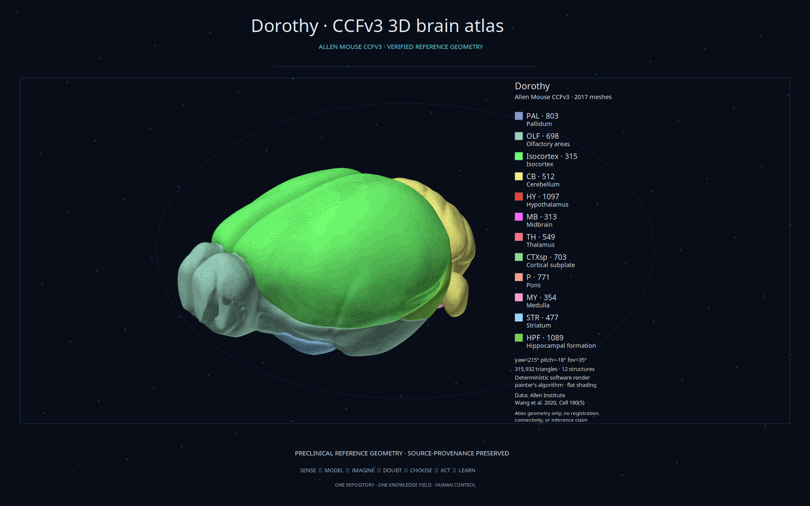

# ZVA-0330 — Dorothy CCFv3 2017

[Visual archive index](../../README.md) · [Full catalog](../README.md) · [Category: Research figures and measurements](../categories/research-figure.md)

## What this image shows

Dorothy’s deterministic twelve-structure Allen Mouse CCFv3 rendering, with structure labels, triangle count, camera state, and an explicit no-registration/no-connectivity boundary.

## Role in Zoe

This visual belongs to Dorothy’s inspectable spatial-research program, making reference geometry or a review instrument available for direct inspection.

## Provenance and evidence boundary

**Provenance:** Zoe render using Allen Institute reference data.

Preclinical mouse-atlas geometry only; not patient anatomy, registration, diagnosis, or treatment evidence.

## File identity

- Archive ID: **ZVA-0330**
- Visual family: **dorothy-ccf2017**
- Dimensions/format: **1920×1200 PNG**
- Frames: **1**
- Bytes: **521,363**
- SHA-256: `980ba9d0872f53420197a7c7f41305aac6cdd85af66d050475bbd2fc5a07933a`
- Original file: [Open full resolution](../../images/ZVA-0330.png)

## Source occurrences

Byte-identical copies are archived once while every known source path remains recorded.

| Source repository/collection | Original path | Canonical link |
|---|---|---|
| zoe | `guiai-lab/docs/images/dorothy-ccf2017.png` | [Source](https://github.com/Ablation-Tool/zoe/blob/main/guiai-lab/docs/images/dorothy-ccf2017.png) |

## Documented context

### 1. Dorothy ccf2017

Source document: `zoe:research/papers/galleries/zoe-dorothy/README.md`

Dorothy and Neurogarden — Visual research index: Dorothy ccf2017

`assets/native/dorothy-ccf2017.png`

### 1. Dorothy ccf2017

Source document: `zoe:research/papers/galleries/zoe-research/README.md`

Complete Zoe research asset index: Dorothy ccf2017

`assets/dorothy/dorothy-ccf2017.png`

## Related format/size variants

- [ZVA-0134](ZVA-0134.md)
- [ZVA-0331](ZVA-0331.md)
