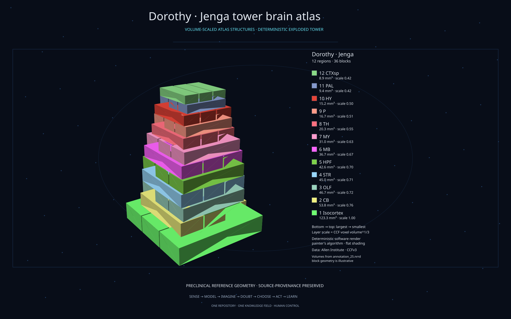

# ZVA-0333 — Dorothy Jenga Exploded

[Visual archive index](../../README.md) · [Full catalog](../README.md) · [Category: Research figures and measurements](../categories/research-figure.md)

## What this image shows

Dorothy Jenga’s volume-scaled exploded tower, offering spatial inspection of atlas structures without asserting anatomical relationships beyond the reference model. This visual belongs to Dorothy’s inspectable spatial-research program, making reference geometry or a review instrument available for direct inspection.

## Role in Zoe

This visual belongs to Dorothy’s inspectable spatial-research program, making reference geometry or a review instrument available for direct inspection.

## Provenance and evidence boundary

**Provenance:** Zoe render using Allen Institute reference data.

Preclinical mouse-atlas geometry only; not patient anatomy, registration, diagnosis, or treatment evidence.

## File identity

- Archive ID: **ZVA-0333**
- Visual family: **dorothy-jenga-exploded**
- Dimensions/format: **SVG 1920×1200**
- Frames: **vector/not applicable**
- Bytes: **70,684**
- SHA-256: `e28594a2c5716290270e151dc3aaf5ecdb0d19ea226d8f1319eede2ecca49899`
- Original file: [Open full resolution](../../images/ZVA-0333.svg)

## Source occurrences

Byte-identical copies are archived once while every known source path remains recorded.

| Source repository/collection | Original path | Canonical link |
|---|---|---|
| zoe | `guiai-lab/docs/images/dorothy-jenga-exploded.svg` | [Source](https://github.com/Ablation-Tool/zoe/blob/main/guiai-lab/docs/images/dorothy-jenga-exploded.svg) |

## Related format/size variants

- [ZVA-0135](ZVA-0135.md)
- [ZVA-0332](ZVA-0332.md)
