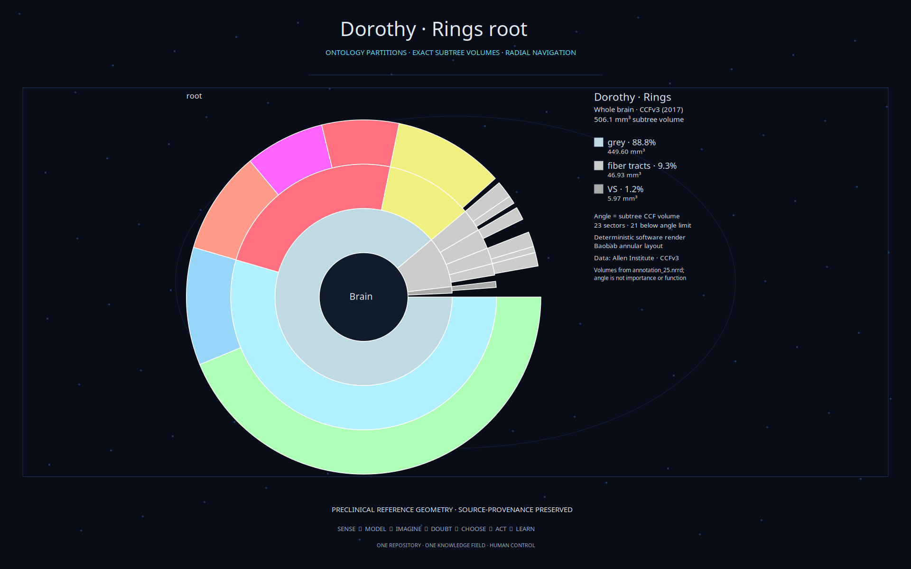

# ZVA-0334 — Dorothy Rings Isocortex

[Visual archive index](../../README.md) · [Full catalog](../README.md) · [Category: Research figures and measurements](../categories/research-figure.md)

## What this image shows

Dorothy Rings applied to isocortex ontology: exact subtree volumes are represented as a navigable radial partition, not as functional importance. This visual belongs to Dorothy’s inspectable spatial-research program, making reference geometry or a review instrument available for direct inspection.

## Role in Zoe

This visual belongs to Dorothy’s inspectable spatial-research program, making reference geometry or a review instrument available for direct inspection.

## Provenance and evidence boundary

**Provenance:** Zoe render using Allen Institute reference data.

Preclinical mouse-atlas geometry only; not patient anatomy, registration, diagnosis, or treatment evidence.

## File identity

- Archive ID: **ZVA-0334**
- Visual family: **dorothy-rings-isocortex**
- Dimensions/format: **1920×1200 PNG**
- Frames: **1**
- Bytes: **171,890**
- SHA-256: `bf3257632ce7f9d28bbd9c54dcf770c246dfb39e286c9594b48f922afcc66db4`
- Original file: [Open full resolution](../../images/ZVA-0334.png)

## Source occurrences

Byte-identical copies are archived once while every known source path remains recorded.

| Source repository/collection | Original path | Canonical link |
|---|---|---|
| zoe | `guiai-lab/docs/images/dorothy-rings-isocortex.png` | [Source](https://github.com/Ablation-Tool/zoe/blob/main/guiai-lab/docs/images/dorothy-rings-isocortex.png) |

## Documented context

### 4. Dorothy rings isocortex

Source document: `zoe:research/papers/galleries/zoe-dorothy/README.md`

Dorothy and Neurogarden — Visual research index: Dorothy rings isocortex

`assets/native/dorothy-rings-isocortex.png`

### 6. Dorothy rings isocortex

Source document: `zoe:research/papers/galleries/zoe-research/README.md`

Complete Zoe research asset index: Dorothy rings isocortex

`assets/dorothy/dorothy-rings-isocortex.png`

## Related format/size variants

- [ZVA-0136](ZVA-0136.md)
- [ZVA-0335](ZVA-0335.md)
