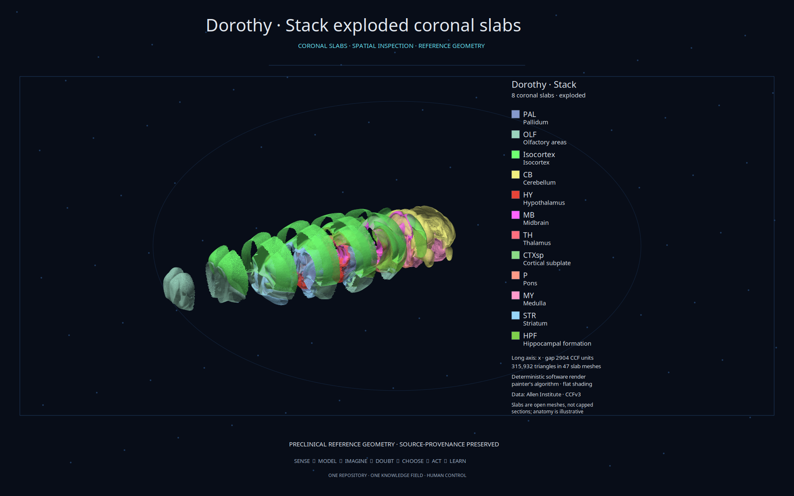

# ZVA-0336 — Dorothy Stack

[Visual archive index](../../README.md) · [Full catalog](../README.md) · [Category: Research figures and measurements](../categories/research-figure.md)

## What this image shows

Dorothy Stack is a research figures and measurements asset from the guiai-lab portion of the Zoe/allgems project. This visual belongs to Dorothy’s inspectable spatial-research program, making reference geometry or a review instrument available for direct inspection.

## Role in Zoe

This visual belongs to Dorothy’s inspectable spatial-research program, making reference geometry or a review instrument available for direct inspection.

## Provenance and evidence boundary

**Provenance:** Zoe render using Allen Institute reference data.

Preclinical mouse-atlas geometry only; not patient anatomy, registration, diagnosis, or treatment evidence.

## File identity

- Archive ID: **ZVA-0336**
- Visual family: **dorothy-stack**
- Dimensions/format: **1920×1200 PNG**
- Frames: **1**
- Bytes: **331,807**
- SHA-256: `22c6818ffeff1d68138dd8bca8b1e9361d57652d3707ef380c28fddcc505bfe0`
- Original file: [Open full resolution](../../images/ZVA-0336.png)

## Source occurrences

Byte-identical copies are archived once while every known source path remains recorded.

| Source repository/collection | Original path | Canonical link |
|---|---|---|
| zoe | `guiai-lab/docs/images/dorothy-stack.png` | [Source](https://github.com/Ablation-Tool/zoe/blob/main/guiai-lab/docs/images/dorothy-stack.png) |

## Related format/size variants

- [ZVA-0337](ZVA-0337.md)
