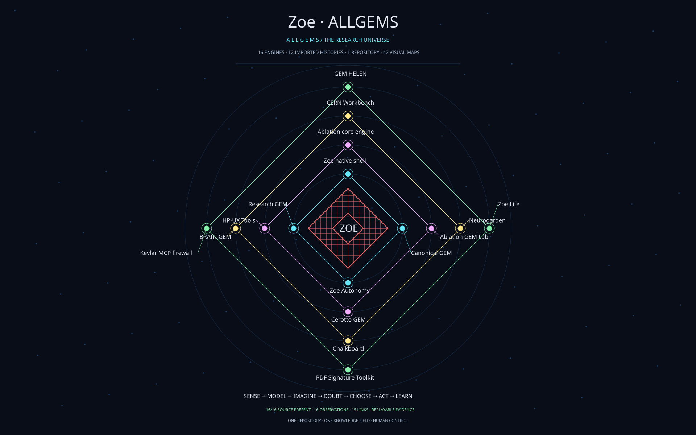

# ZVA-0339 — GEM Unified

[Visual archive index](../../README.md) · [Full catalog](../README.md) · [Category: Research figures and measurements](../categories/research-figure.md)

## What this image shows

The unified Zoe knowledge-engineering hub with the current woven-diamond vector emblem, sixteen registered engines, one repository, and the replayable knowledge field. This figure preserves a measurement, model output, simulation, geometric construction, or research explanation from the Zoe/allgems program.

## Role in Zoe

This figure preserves a measurement, model output, simulation, geometric construction, or research explanation from the Zoe/allgems program.

## Provenance and evidence boundary

**Provenance:** Zoe/allgems project-generated visual.

The image is preserved with its source context; the visual alone does not prove a scientific or operational claim.

## File identity

- Archive ID: **ZVA-0339**
- Visual family: **gem-unified**
- Dimensions/format: **1920×1200 PNG**
- Frames: **1**
- Bytes: **206,140**
- SHA-256: `0f946b87618f8a133dc52b000b1008b14c4b8a01027552a681146caea6083e37`
- Original file: [Open full resolution](../../images/ZVA-0339.png)

## Source occurrences

Byte-identical copies are archived once while every known source path remains recorded.

| Source repository/collection | Original path | Canonical link |
|---|---|---|
| zoe | `guiai-lab/docs/images/gem-unified.png` | [Source](https://github.com/Ablation-Tool/zoe/blob/main/guiai-lab/docs/images/gem-unified.png) |

## Documented context

### Zoe

Source document: `zoe:README.md`

Zoe unified knowledge-engineering hub

**One repository. Twelve imported source histories. Twelve runtime source projects. Sixteen registered engines. No submodules or runtime source downloads.** Quick start · AGI/ASI acceptance roadmap · Complete capability atlas · Monorepo guide · 23-page research monograph · Research library · Visual archive

### Geometry and evidence

Source document: `zoe:research/papers/zoe-research/docs/native/VISUAL-GUIDES.md`

Unified knowledge-engineering hub

Five-panel causal geometry guide{width=48%} Procrustes landmark playground{width=48%} **Unified architecture and verification · Zoe: living geometry, inspectable futures**

### 11. Gem unified

Source document: `zoe:research/papers/galleries/zoe-research/README.md`

Complete Zoe research asset index: Gem unified

`assets/native/gem-unified.png`

### Geometry and evidence

Source document: `zoe:guiai-lab/docs/VISUAL-GUIDES.md`

Unified knowledge-engineering hub

Five-panel causal geometry guide{width=48%} Procrustes landmark playground{width=48%} **Unified architecture and verification · Zoe: living geometry, inspectable futures**

## Related format/size variants

- [ZVA-0340](ZVA-0340.md)
