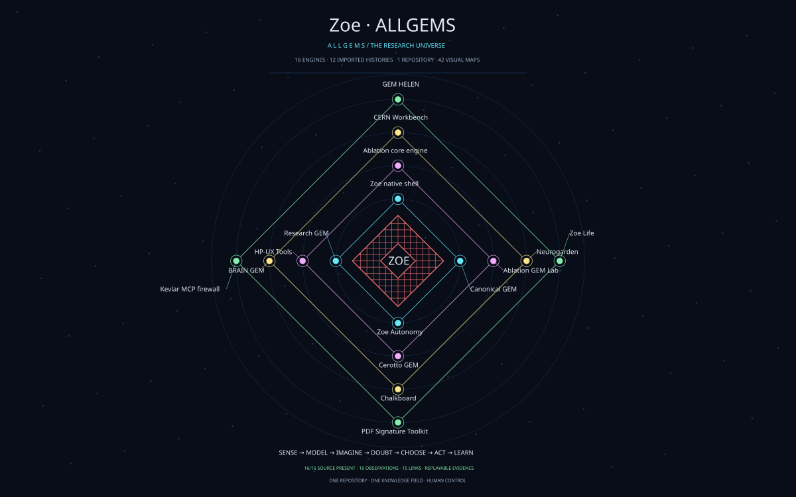

# ZVA-0340 — GEM Unified

[Visual archive index](../../README.md) · [Full catalog](../README.md) · [Category: Research figures and measurements](../categories/research-figure.md)

## What this image shows

The unified Zoe knowledge-engineering hub with the current woven-diamond vector emblem, sixteen registered engines, one repository, and the replayable knowledge field. This figure preserves a measurement, model output, simulation, geometric construction, or research explanation from the Zoe/allgems program.

## Role in Zoe

This figure preserves a measurement, model output, simulation, geometric construction, or research explanation from the Zoe/allgems program.

## Provenance and evidence boundary

**Provenance:** Zoe/allgems project-generated visual.

The image is preserved with its source context; the visual alone does not prove a scientific or operational claim.

## File identity

- Archive ID: **ZVA-0340**
- Visual family: **gem-unified**
- Dimensions/format: **SVG 1200×750**
- Frames: **vector/not applicable**
- Bytes: **38,448**
- SHA-256: `a0e043435054aa0212e6354f4ba8f2ba69fe6ce3f173687be9ff8ef30513b788`
- Original file: [Open full resolution](../../images/ZVA-0340.svg)

## Source occurrences

Byte-identical copies are archived once while every known source path remains recorded.

| Source repository/collection | Original path | Canonical link |
|---|---|---|
| zoe | `guiai-lab/docs/images/gem-unified.svg` | [Source](https://github.com/Ablation-Tool/zoe/blob/main/guiai-lab/docs/images/gem-unified.svg) |

## Documented context

### 12. Gem unified

Source document: `zoe:research/papers/galleries/zoe-research/README.md`

Complete Zoe research asset index: Gem unified

`assets/native/gem-unified.svg`

## Related format/size variants

- [ZVA-0339](ZVA-0339.md)
