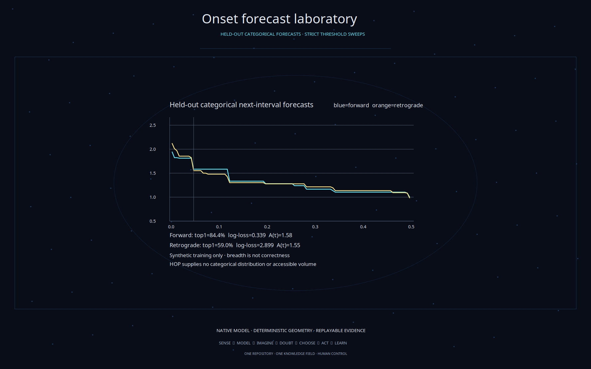

# ZVA-0350 — Geometry Atlas Onset

[Visual archive index](../../README.md) · [Full catalog](../README.md) · [Category: Research figures and measurements](../categories/research-figure.md)

## What this image shows

Native Onset forecast laboratory. This figure preserves a measurement, model output, simulation, geometric construction, or research explanation from the Zoe/allgems program.

## Role in Zoe

This figure preserves a measurement, model output, simulation, geometric construction, or research explanation from the Zoe/allgems program.

## Provenance and evidence boundary

**Provenance:** Zoe/allgems project-generated visual.

The image is preserved with its source context; the visual alone does not prove a scientific or operational claim.

## File identity

- Archive ID: **ZVA-0350**
- Visual family: **geometry-atlas-onset**
- Dimensions/format: **1920×1200 PNG**
- Frames: **1**
- Bytes: **105,862**
- SHA-256: `eb12c6f06d57d39fd0db376cb6aba01955a2f01a02696c1176785dcf1380bdba`
- Original file: [Open full resolution](../../images/ZVA-0350.png)

## Source occurrences

Byte-identical copies are archived once while every known source path remains recorded.

| Source repository/collection | Original path | Canonical link |
|---|---|---|
| zoe | `guiai-lab/docs/images/geometry-atlas-onset.png` | [Source](https://github.com/Ablation-Tool/zoe/blob/main/guiai-lab/docs/images/geometry-atlas-onset.png) |

## Documented context

### GEM Geometry Atlas

Source document: `zoe:research/papers/zoe-research/docs/native/GEOMETRY-ATLAS.md`

Native Onset forecast laboratory

The Geometry Atlas is a native GTK laboratory inside Ablation's GEM. It turns the extracted reference geometry into interactive Spatial IR scenes and uses the existing Cairo, SVG, PNG, and GEM VDI renderers. It does not start a web server or require a browser.

### 14. Geometry atlas onset

Source document: `zoe:research/papers/galleries/zoe-research/README.md`

Complete Zoe research asset index: Geometry atlas onset

`assets/native/geometry-atlas-onset.png`

### GEM Geometry Atlas

Source document: `zoe:guiai-lab/docs/GEOMETRY-ATLAS.md`

Native Onset forecast laboratory

The Geometry Atlas is a native GTK laboratory inside Ablation's GEM. It turns the extracted reference geometry into interactive Spatial IR scenes and uses the existing Cairo, SVG, PNG, and GEM VDI renderers. It does not start a web server or require a browser.

## Related format/size variants

- [ZVA-0351](ZVA-0351.md)
