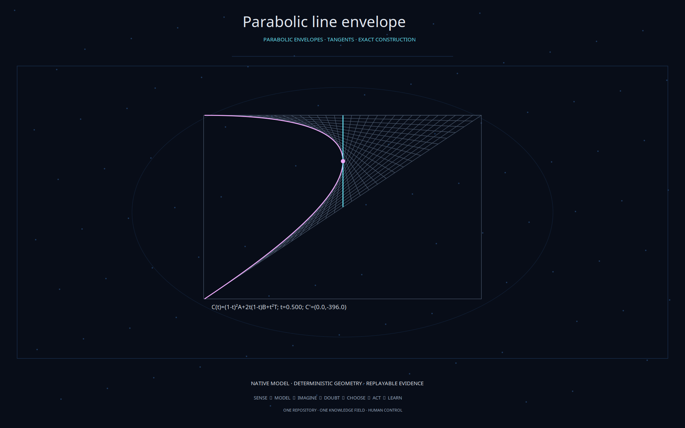

# ZVA-0352 — Geometry Atlas Parabola

[Visual archive index](../../README.md) · [Full catalog](../README.md) · [Category: Research figures and measurements](../categories/research-figure.md)

## What this image shows

Geometry Atlas Parabola is a research figures and measurements asset from the guiai-lab portion of the Zoe/allgems project. This figure preserves a measurement, model output, simulation, geometric construction, or research explanation from the Zoe/allgems program.

## Role in Zoe

This figure preserves a measurement, model output, simulation, geometric construction, or research explanation from the Zoe/allgems program.

## Provenance and evidence boundary

**Provenance:** Zoe/allgems project-generated visual.

The image is preserved with its source context; the visual alone does not prove a scientific or operational claim.

## File identity

- Archive ID: **ZVA-0352**
- Visual family: **geometry-atlas-parabola**
- Dimensions/format: **1920×1200 PNG**
- Frames: **1**
- Bytes: **163,653**
- SHA-256: `c91dbf3ed23e0101dcc38e96e01b32c03647b670841047645308c2e63ad2818f`
- Original file: [Open full resolution](../../images/ZVA-0352.png)

## Source occurrences

Byte-identical copies are archived once while every known source path remains recorded.

| Source repository/collection | Original path | Canonical link |
|---|---|---|
| zoe | `guiai-lab/docs/images/geometry-atlas-parabola.png` | [Source](https://github.com/Ablation-Tool/zoe/blob/main/guiai-lab/docs/images/geometry-atlas-parabola.png) |

## Related format/size variants

- [ZVA-0353](ZVA-0353.md)
