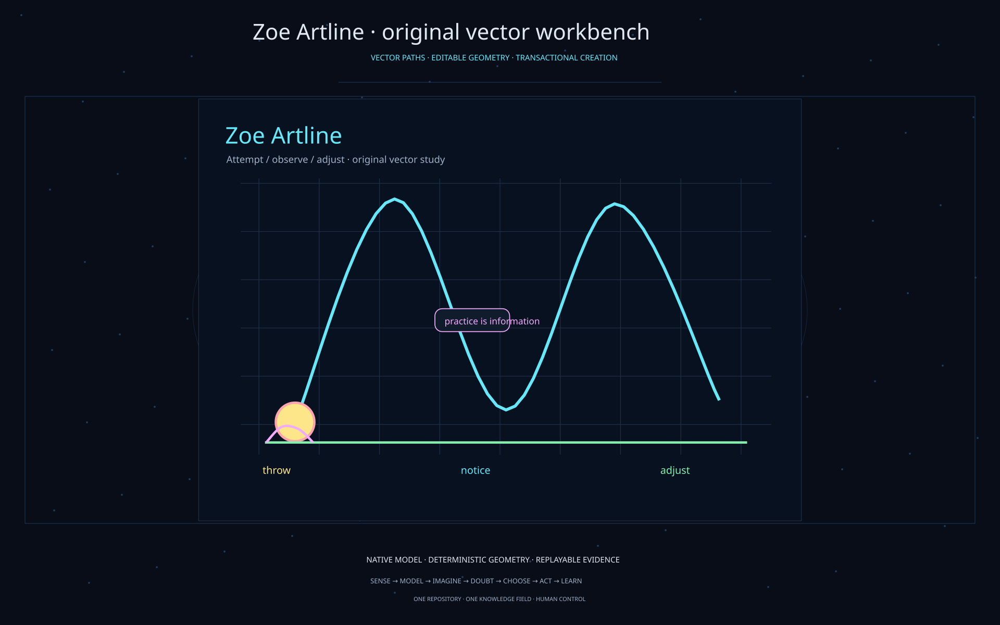

# ZVA-0360 — Zoe Artline

[Visual archive index](../../README.md) · [Full catalog](../README.md) · [Category: Artwork and generative compositions](../categories/artwork.md)

## What this image shows

Zoe Artline’s original vector study: an interactive mathematical curve and highlighted moving point presented in the project’s restrained native visual language. This is part of Zoe’s creative geometry and generative-art practice, preserving the artistic side of the project alongside its scientific instruments.

## Role in Zoe

This is part of Zoe’s creative geometry and generative-art practice, preserving the artistic side of the project alongside its scientific instruments.

## Provenance and evidence boundary

**Provenance:** Zoe/allgems project-generated visual.

The image is preserved with its source context; the visual alone does not prove a scientific or operational claim.

## File identity

- Archive ID: **ZVA-0360**
- Visual family: **zoe-artline**
- Dimensions/format: **SVG 1920×1200**
- Frames: **vector/not applicable**
- Bytes: **27,653**
- SHA-256: `7ab54f1253d6c76b8b7f00afe63104c0c24ceaef89ab7a08df2737ab5bf3f72e`
- Original file: [Open full resolution](../../images/ZVA-0360.svg)

## Source occurrences

Byte-identical copies are archived once while every known source path remains recorded.

| Source repository/collection | Original path | Canonical link |
|---|---|---|
| zoe | `guiai-lab/docs/images/zoe-artline.svg` | [Source](https://github.com/Ablation-Tool/zoe/blob/main/guiai-lab/docs/images/zoe-artline.svg) |

## Documented context

### 22. Zoe artline

Source document: `zoe:research/papers/galleries/zoe-research/README.md`

Complete Zoe research asset index: Zoe artline

`assets/native/zoe-artline.svg`

## Related format/size variants

- [ZVA-0359](ZVA-0359.md)
