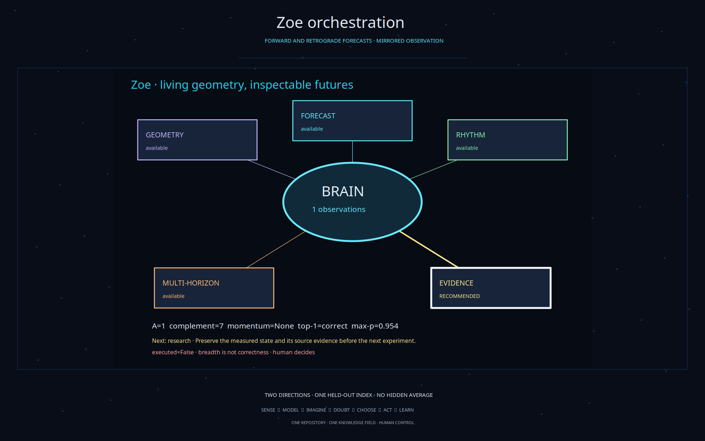

# ZVA-0361 — Zoe Brain

[Visual archive index](../../README.md) · [Full catalog](../README.md) · [Category: Research–art compositions](../categories/research-art.md)

## What this image shows

The native Zoe BRAIN observation window, showing stored forecast correctness, operational metacognition, momentum, and a deterministic next-module recommendation rather than the separate Zoe brain artwork.

## Role in Zoe

This image connects a mathematical or conceptual research idea with an original visual composition, allowing the idea to function as both an instrument and an artwork.

## Provenance and evidence boundary

**Provenance:** Nicholas–Zoe collaborative visual research.

Artistic and conceptual imagery is not anatomical, conscious, or empirical evidence by itself.

## File identity

- Archive ID: **ZVA-0361**
- Visual family: **zoe-brain**
- Dimensions/format: **1920×1200 PNG**
- Frames: **1**
- Bytes: **100,653**
- SHA-256: `13202a94e332fc3c1840ddf18c18b7f5a4a3655b6fed6c7c870fd017b4b13f17`
- Original file: [Open full resolution](../../images/ZVA-0361.png)

## Source occurrences

Byte-identical copies are archived once while every known source path remains recorded.

| Source repository/collection | Original path | Canonical link |
|---|---|---|
| zoe | `guiai-lab/docs/images/zoe-brain.png` | [Source](https://github.com/Ablation-Tool/zoe/blob/main/guiai-lab/docs/images/zoe-brain.png) |

## Documented context

### Geometry and evidence

Source document: `zoe:research/papers/zoe-research/docs/native/VISUAL-GUIDES.md`

Zoe BRAIN observation scene

Five-panel causal geometry guide{width=48%} Procrustes landmark playground{width=48%} **Unified architecture and verification · Zoe: living geometry, inspectable futures**

### Zoe — living geometry, inspectable futures

Source document: `zoe:research/papers/zoe-research/docs/native/ZOE.md`

Zoe native BRAIN after a real HELEN observation

Zoe unifies **GEM HELEN + MASTER GEM + BRAIN GEM** inside Ablation's native GEM host. HELEN supplies lightweight creative geometry and stored categorical predictions. next-token-predictability supplies research evidence and numerical conformance. Ablation supplies native GTK, Spatial IR, Lab integration, VDI replay, and evidence export. BRAIN is the deterministic observation and recommendation layer; it is not a consciousness claim or an autonomous agent.

### 24. Zoe brain

Source document: `zoe:research/papers/galleries/zoe-research/README.md`

Complete Zoe research asset index: Zoe brain

`assets/native/zoe-brain.png`

### Geometry and evidence

Source document: `zoe:guiai-lab/docs/VISUAL-GUIDES.md`

Zoe BRAIN observation scene

Five-panel causal geometry guide{width=48%} Procrustes landmark playground{width=48%} **Unified architecture and verification · Zoe: living geometry, inspectable futures**

### Zoe — living geometry, inspectable futures

Source document: `zoe:guiai-lab/docs/ZOE.md`

Zoe native BRAIN after a real HELEN observation

Zoe unifies **GEM HELEN + MASTER GEM + BRAIN GEM** inside Ablation's native GEM host. HELEN supplies lightweight creative geometry and stored categorical predictions. next-token-predictability supplies research evidence and numerical conformance. Ablation supplies native GTK, Spatial IR, Lab integration, VDI replay, and evidence export. BRAIN is the deterministic observation and recommendation layer; it is not a consciousness claim or an autonomous agent.

## Related format/size variants

- [ZVA-0096](ZVA-0096.md)
- [ZVA-0097](ZVA-0097.md)
- [ZVA-0362](ZVA-0362.md)
