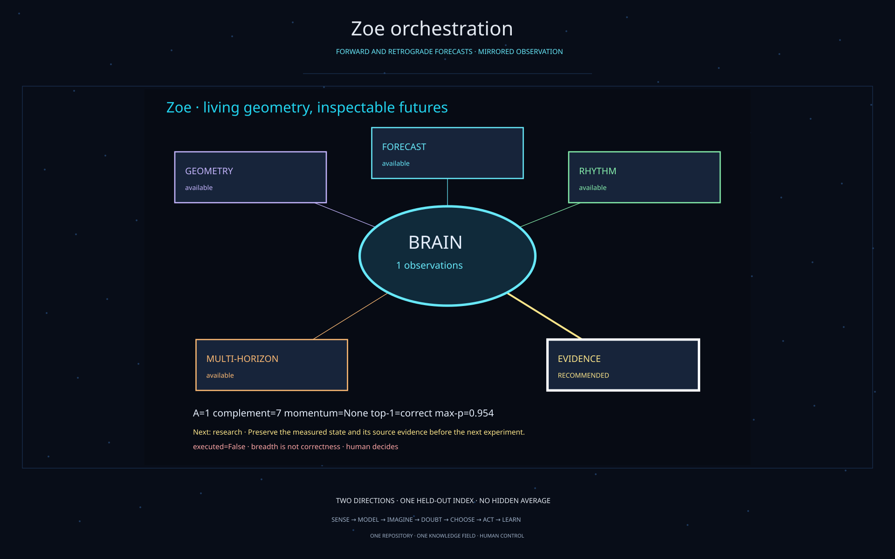

# ZVA-0362 — Zoe Brain

[Visual archive index](../../README.md) · [Full catalog](../README.md) · [Category: Research–art compositions](../categories/research-art.md)

## What this image shows

The native Zoe BRAIN observation window, showing stored forecast correctness, operational metacognition, momentum, and a deterministic next-module recommendation rather than the separate Zoe brain artwork.

## Role in Zoe

This image connects a mathematical or conceptual research idea with an original visual composition, allowing the idea to function as both an instrument and an artwork.

## Provenance and evidence boundary

**Provenance:** Nicholas–Zoe collaborative visual research.

Artistic and conceptual imagery is not anatomical, conscious, or empirical evidence by itself.

## File identity

- Archive ID: **ZVA-0362**
- Visual family: **zoe-brain**
- Dimensions/format: **SVG 1920×1200**
- Frames: **vector/not applicable**
- Bytes: **25,463**
- SHA-256: `7fff1ee13a8ef52a32d1a92ac3d60505f41b65fff82ddced6adf0ae9f86d4558`
- Original file: [Open full resolution](../../images/ZVA-0362.svg)

## Source occurrences

Byte-identical copies are archived once while every known source path remains recorded.

| Source repository/collection | Original path | Canonical link |
|---|---|---|
| zoe | `guiai-lab/docs/images/zoe-brain.svg` | [Source](https://github.com/Ablation-Tool/zoe/blob/main/guiai-lab/docs/images/zoe-brain.svg) |

## Related format/size variants

- [ZVA-0096](ZVA-0096.md)
- [ZVA-0097](ZVA-0097.md)
- [ZVA-0361](ZVA-0361.md)
