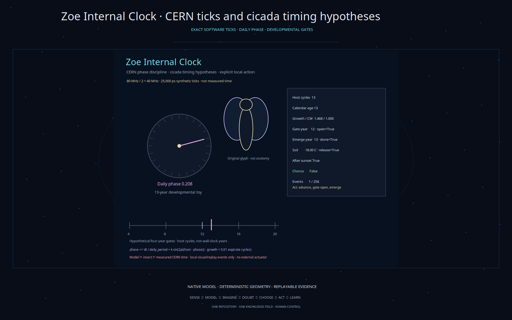

# ZVA-0364 — Zoe Cicada

[Visual archive index](../../README.md) · [Full catalog](../README.md) · [Category: Research figures and measurements](../categories/research-figure.md)

## What this image shows

Zoe Internal Clock. This figure preserves a measurement, model output, simulation, geometric construction, or research explanation from the Zoe/allgems program.

## Role in Zoe

This figure preserves a measurement, model output, simulation, geometric construction, or research explanation from the Zoe/allgems program.

## Provenance and evidence boundary

**Provenance:** Zoe/allgems project-generated visual.

The image is preserved with its source context; the visual alone does not prove a scientific or operational claim.

## File identity

- Archive ID: **ZVA-0364**
- Visual family: **zoe-cicada**
- Dimensions/format: **1920×1200 PNG**
- Frames: **1**
- Bytes: **132,595**
- SHA-256: `2f0ebe729f4c72e836490f3e0e6dea75eadb32a63f899658472b179767569518`
- Original file: [Open full resolution](../../images/ZVA-0364.png)

## Source occurrences

Byte-identical copies are archived once while every known source path remains recorded.

| Source repository/collection | Original path | Canonical link |
|---|---|---|
| zoe | `guiai-lab/docs/images/zoe-cicada.png` | [Source](https://github.com/Ablation-Tool/zoe/blob/main/guiai-lab/docs/images/zoe-cicada.png) |

## Documented context

### Zoe Internal Clock

Source document: `zoe:research/papers/zoe-research/docs/native/CICADA.md`

Zoe Internal Clock

**Zoe Internal Clock is a deterministic timing instrument informed by CERN clock distribution and the biological study of cicada timing.** It advances a local state machine—`advance`, `daily-pulse`, `gate-open`, `emerge`, and `chorus`—without a reasoning loop. “Acting without thinking” here means exactly that: after an explicit **Act** action, a bounded local timer advances visual/replay events. It does not mean autonomous hardware control, an AI decision process, a biological measurement, or a claim that the software is a cicada.

### Create and play

Source document: `zoe:research/papers/zoe-research/docs/native/VISUAL-GUIDES.md`

CERN ticks and cicada timing hypotheses

Pentomino regions and legal cube permutations{width=72%} **Zoe Internal Clock**

### 15. Zoe cicada

Source document: `zoe:research/papers/galleries/zoe-cern/README.md`

CERN research in Zoe — Visual research index: Zoe cicada

`assets/native/zoe-cicada.png`

### 26. Zoe cicada

Source document: `zoe:research/papers/galleries/zoe-research/README.md`

Complete Zoe research asset index: Zoe cicada

`assets/native/zoe-cicada.png`

### Zoe Internal Clock

Source document: `zoe:guiai-lab/docs/CICADA.md`

Zoe Internal Clock

**Zoe Internal Clock is a deterministic timing instrument informed by CERN clock distribution and the biological study of cicada timing.** It advances a local state machine—`advance`, `daily-pulse`, `gate-open`, `emerge`, and `chorus`—without a reasoning loop. “Acting without thinking” here means exactly that: after an explicit **Act** action, a bounded local timer advances visual/replay events. It does not mean autonomous hardware control, an AI decision process, a biological measurement, or a claim that the software is a cicada.

### Create and play

Source document: `zoe:guiai-lab/docs/VISUAL-GUIDES.md`

CERN ticks and cicada timing hypotheses

Pentomino regions and legal cube permutations{width=72%} **Zoe Internal Clock**

## Related format/size variants

- [ZVA-0365](ZVA-0365.md)
