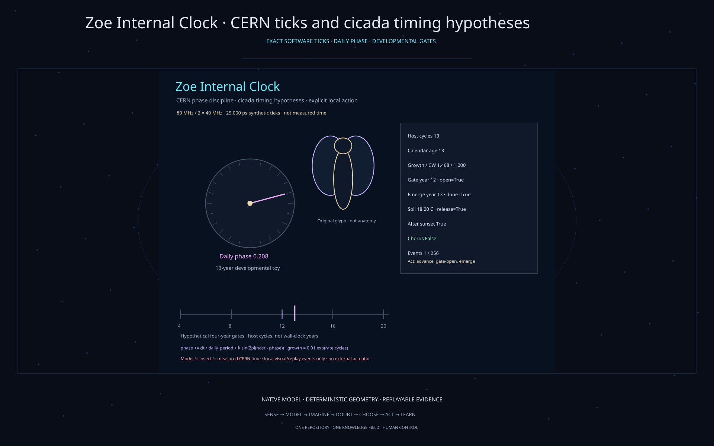

# ZVA-0365 — Zoe Cicada

[Visual archive index](../../README.md) · [Full catalog](../README.md) · [Category: Research figures and measurements](../categories/research-figure.md)

## What this image shows

Complete Zoe research asset index: Zoe cicada. This figure preserves a measurement, model output, simulation, geometric construction, or research explanation from the Zoe/allgems program.

## Role in Zoe

This figure preserves a measurement, model output, simulation, geometric construction, or research explanation from the Zoe/allgems program.

## Provenance and evidence boundary

**Provenance:** Zoe/allgems project-generated visual.

The image is preserved with its source context; the visual alone does not prove a scientific or operational claim.

## File identity

- Archive ID: **ZVA-0365**
- Visual family: **zoe-cicada**
- Dimensions/format: **SVG 1920×1200**
- Frames: **vector/not applicable**
- Bytes: **34,655**
- SHA-256: `0817dfed372c1685555966f9ab6b3d553490ec401aed2f12d94c84277a76e288`
- Original file: [Open full resolution](../../images/ZVA-0365.svg)

## Source occurrences

Byte-identical copies are archived once while every known source path remains recorded.

| Source repository/collection | Original path | Canonical link |
|---|---|---|
| zoe | `guiai-lab/docs/images/zoe-cicada.svg` | [Source](https://github.com/Ablation-Tool/zoe/blob/main/guiai-lab/docs/images/zoe-cicada.svg) |

## Documented context

### 27. Zoe cicada

Source document: `zoe:research/papers/galleries/zoe-research/README.md`

Complete Zoe research asset index: Zoe cicada

`assets/native/zoe-cicada.svg`

## Related format/size variants

- [ZVA-0364](ZVA-0364.md)
