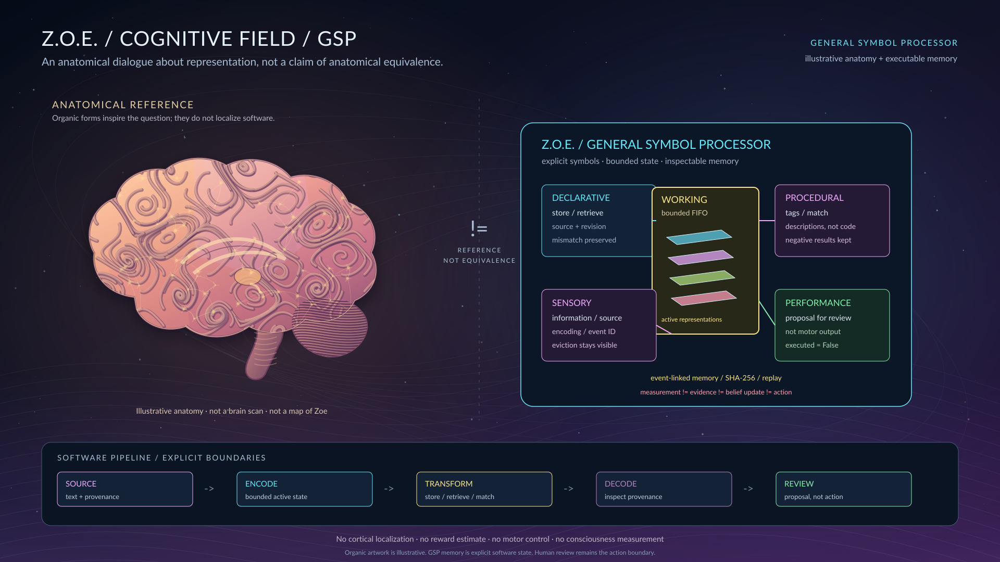

# ZVA-0367 — Zoe Cognitive Anatomy

[Visual archive index](../../README.md) · [Full catalog](../README.md) · [Category: Mechanism and architecture diagrams](../categories/mechanism-diagram.md)

## What this image shows

A conceptual anatomy of Zoe’s cognitive components, mapping memory, proposals, forecasts, and evidence without asserting biological anatomy or consciousness. This diagram explains relationships among components, evidence states, measurements, or decisions without requiring the reader to reconstruct the architecture from code.

## Role in Zoe

This diagram explains relationships among components, evidence states, measurements, or decisions without requiring the reader to reconstruct the architecture from code.

## Provenance and evidence boundary

**Provenance:** Zoe/allgems project-generated visual.

The image is preserved with its source context; the visual alone does not prove a scientific or operational claim.

## File identity

- Archive ID: **ZVA-0367**
- Visual family: **zoe-cognitive-anatomy**
- Dimensions/format: **SVG 1920×1080**
- Frames: **vector/not applicable**
- Bytes: **439,738**
- SHA-256: `221fc7dad658500b05c57ddf8acf79b74a84d5f5a0a705a99f568fdf38cefdfb`
- Original file: [Open full resolution](../../images/ZVA-0367.svg)

## Source occurrences

Byte-identical copies are archived once while every known source path remains recorded.

| Source repository/collection | Original path | Canonical link |
|---|---|---|
| zoe | `guiai-lab/docs/images/zoe-cognitive-anatomy.svg` | [Source](https://github.com/Ablation-Tool/zoe/blob/main/guiai-lab/docs/images/zoe-cognitive-anatomy.svg) |

## Documented context

### 29. Zoe cognitive anatomy

Source document: `zoe:research/papers/galleries/zoe-research/README.md`

Complete Zoe research asset index: Zoe cognitive anatomy

`assets/native/zoe-cognitive-anatomy.svg`

## Related format/size variants

- [ZVA-0366](ZVA-0366.md)
