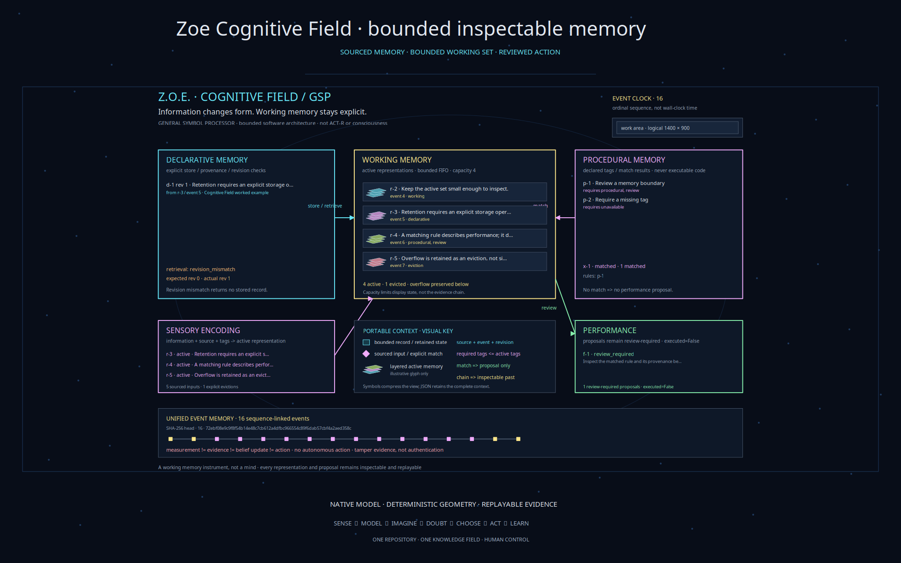

# ZVA-0368 — Zoe Cognitive Field

[Visual archive index](../../README.md) · [Full catalog](../README.md) · [Category: Research figures and measurements](../categories/research-figure.md)

## What this image shows

Zoe Cognitive Field worked example. This figure preserves a measurement, model output, simulation, geometric construction, or research explanation from the Zoe/allgems program.

## Role in Zoe

This figure preserves a measurement, model output, simulation, geometric construction, or research explanation from the Zoe/allgems program.

## Provenance and evidence boundary

**Provenance:** Zoe/allgems project-generated visual.

The image is preserved with its source context; the visual alone does not prove a scientific or operational claim.

## File identity

- Archive ID: **ZVA-0368**
- Visual family: **zoe-cognitive-field**
- Dimensions/format: **1920×1200 PNG**
- Frames: **1**
- Bytes: **201,668**
- SHA-256: `5bf38e1d0f345943d3d6b69c2c5c91691448e43d7a22ce4478099892e86b3d59`
- Original file: [Open full resolution](../../images/ZVA-0368.png)

## Source occurrences

Byte-identical copies are archived once while every known source path remains recorded.

| Source repository/collection | Original path | Canonical link |
|---|---|---|
| zoe | `guiai-lab/docs/images/zoe-cognitive-field.png` | [Source](https://github.com/Ablation-Tool/zoe/blob/main/guiai-lab/docs/images/zoe-cognitive-field.png) |

## Documented context

### Zoe · Cognitive Field

Source document: `zoe:research/papers/zoe-research/docs/native/COGNITIVE.md`

Zoe Cognitive Field worked example

The Cognitive Field is a working, bounded memory instrument and software-level cognitive architecture. It coordinates memory, sensory-like encoding, rule matching, and review-gated performance rather than treating them as disconnected diagrams or claiming to model a human mind. **GSP** means **General Symbol Processor** here: the explicit symbols are sourced text, tags, record IDs, revisions, and rule descriptions. Operations are deterministic transformations and subset matches over those symbols. GSP is not the historical General Problem Solver, a learned model, or a claim of unrestricted general intelligence.

### Create and play

Source document: `zoe:research/papers/zoe-research/docs/native/VISUAL-GUIDES.md`

Cognitive Field worked example

CERN ticks and cicada timing hypotheses{width=72%} **Zoe Practice Navigator · Cognitive Field**

### Functional modules

Source document: `zoe:research/papers/zoe-research/docs/native/ZOE.md`

Zoe Cognitive Field

- **Cognitive Field:** encode sourced observations into bounded FIFO working memory, explicitly store active representations, retrieve them with provenance and revision checks, match declared procedural tags, and prepare review-required performance proposals. No rule is executable code and no measurement updates a posterior automatically. Open **Zoe · Cognitive Field** in the native module selector or run `PYTHONPATH=guiai-lab python -m guiai.gem cognitive --output cognitive-field.png`. See the instrument guide.

### 30. Zoe cognitive field

Source document: `zoe:research/papers/galleries/zoe-research/README.md`

Complete Zoe research asset index: Zoe cognitive field

`assets/native/zoe-cognitive-field.png`

### Zoe · Cognitive Field

Source document: `zoe:guiai-lab/docs/COGNITIVE.md`

Zoe Cognitive Field worked example

The Cognitive Field is a working, bounded memory instrument and software-level cognitive architecture. It coordinates memory, sensory-like encoding, rule matching, and review-gated performance rather than treating them as disconnected diagrams or claiming to model a human mind. **GSP** means **General Symbol Processor** here: the explicit symbols are sourced text, tags, record IDs, revisions, and rule descriptions. Operations are deterministic transformations and subset matches over those symbols. GSP is not the historical General Problem Solver, a learned model, or a claim of unrestricted general intelligence.

### Create and play

Source document: `zoe:guiai-lab/docs/VISUAL-GUIDES.md`

Cognitive Field worked example

CERN ticks and cicada timing hypotheses{width=72%} **Zoe Practice Navigator · Cognitive Field**

### Functional modules

Source document: `zoe:guiai-lab/docs/ZOE.md`

Zoe Cognitive Field

- **Cognitive Field:** encode sourced observations into bounded FIFO working memory, explicitly store active representations, retrieve them with provenance and revision checks, match declared procedural tags, and prepare review-required performance proposals. No rule is executable code and no measurement updates a posterior automatically. Open **Zoe · Cognitive Field** in the native module selector or run `PYTHONPATH=guiai-lab python -m guiai.gem cognitive --output cognitive-field.png`. See the instrument guide.

## Related format/size variants

- [ZVA-0369](ZVA-0369.md)
