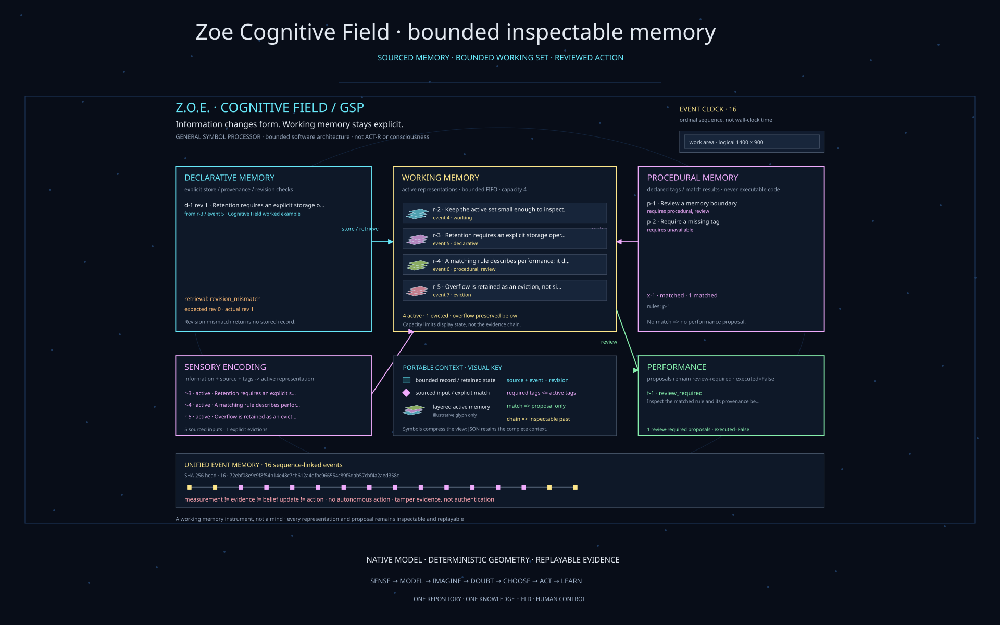

# ZVA-0369 — Zoe Cognitive Field

[Visual archive index](../../README.md) · [Full catalog](../README.md) · [Category: Research figures and measurements](../categories/research-figure.md)

## What this image shows

Complete Zoe research asset index: Zoe cognitive field. This figure preserves a measurement, model output, simulation, geometric construction, or research explanation from the Zoe/allgems program.

## Role in Zoe

This figure preserves a measurement, model output, simulation, geometric construction, or research explanation from the Zoe/allgems program.

## Provenance and evidence boundary

**Provenance:** Zoe/allgems project-generated visual.

The image is preserved with its source context; the visual alone does not prove a scientific or operational claim.

## File identity

- Archive ID: **ZVA-0369**
- Visual family: **zoe-cognitive-field**
- Dimensions/format: **SVG 1920×1200**
- Frames: **vector/not applicable**
- Bytes: **49,508**
- SHA-256: `c0123713e274f3bd3a7a9e7c62a766ecb02559c11031e4a8add200d55c218f6f`
- Original file: [Open full resolution](../../images/ZVA-0369.svg)

## Source occurrences

Byte-identical copies are archived once while every known source path remains recorded.

| Source repository/collection | Original path | Canonical link |
|---|---|---|
| zoe | `guiai-lab/docs/images/zoe-cognitive-field.svg` | [Source](https://github.com/Ablation-Tool/zoe/blob/main/guiai-lab/docs/images/zoe-cognitive-field.svg) |

## Documented context

### 31. Zoe cognitive field

Source document: `zoe:research/papers/galleries/zoe-research/README.md`

Complete Zoe research asset index: Zoe cognitive field

`assets/native/zoe-cognitive-field.svg`

## Related format/size variants

- [ZVA-0368](ZVA-0368.md)
