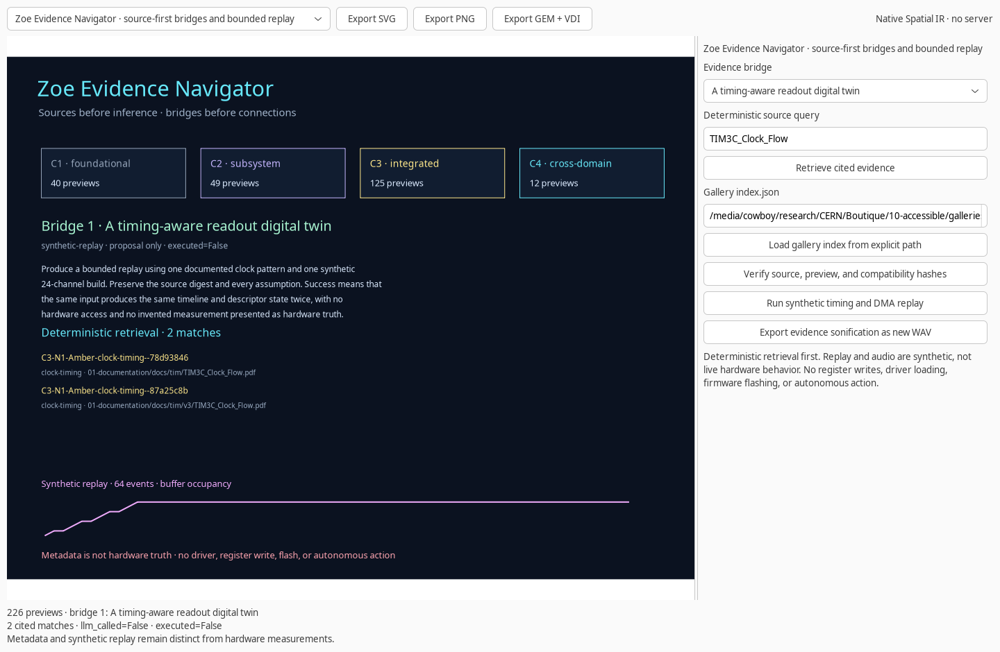

# ZVA-0371 — Zoe Evidence Native

[Visual archive index](../../README.md) · [Full catalog](../README.md) · [Category: Native interfaces and application scenes](../categories/interface.md)

## What this image shows

Native Zoe Evidence Navigator. This image documents a native, mobile, browser, or desktop interface and its available controls at a particular recorded state.

## Role in Zoe

This image documents a native, mobile, browser, or desktop interface and its available controls at a particular recorded state.

## Provenance and evidence boundary

**Provenance:** Zoe project interface capture.

A screenshot documents the displayed interface state; it is not independent experimental validation.

## File identity

- Archive ID: **ZVA-0371**
- Visual family: **zoe-evidence-native**
- Dimensions/format: **1440×940 PNG**
- Frames: **1**
- Bytes: **121,676**
- SHA-256: `5165b3874d7096d5e3a77e1d581e9b45bf92cdc2aa609b42c74a3e070f06da7c`
- Original file: [Open full resolution](../../images/ZVA-0371.png)

## Source occurrences

Byte-identical copies are archived once while every known source path remains recorded.

| Source repository/collection | Original path | Canonical link |
|---|---|---|
| zoe | `guiai-lab/docs/images/zoe-evidence-native.png` | [Source](https://github.com/Ablation-Tool/zoe/blob/main/guiai-lab/docs/images/zoe-evidence-native.png) |

## Documented context

### Verification

Source document: `zoe:research/papers/zoe-research/docs/native/EVIDENCE.md`

Native Zoe Evidence Navigator

The suite covers schema and distribution checks, source and preview hashes, compatibility links, all seven bridges, missing-evidence behavior, curriculum prompts, protocol schemas, observation controls, shadow retrieval, replay and audio determinism, CLI workflows, and native load/verify/replay/export paths.

### 5. Zoe evidence native

Source document: `zoe:research/papers/galleries/zoe-cern/README.md`

CERN research in Zoe — Visual research index: Zoe evidence native

`assets/native/zoe-evidence-native.png`

### 33. Zoe evidence native

Source document: `zoe:research/papers/galleries/zoe-research/README.md`

Complete Zoe research asset index: Zoe evidence native

`assets/native/zoe-evidence-native.png`

### Verification

Source document: `zoe:guiai-lab/docs/EVIDENCE.md`

Native Zoe Evidence Navigator

The suite covers schema and distribution checks, source and preview hashes, compatibility links, all seven bridges, missing-evidence behavior, curriculum prompts, protocol schemas, observation controls, shadow retrieval, replay and audio determinism, CLI workflows, and native load/verify/replay/export paths.
