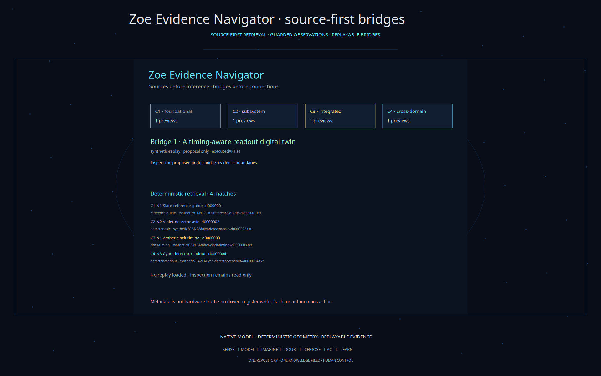

# ZVA-0372 — Zoe Evidence

[Visual archive index](../../README.md) · [Full catalog](../README.md) · [Category: Research figures and measurements](../categories/research-figure.md)

<a href="../../images/ZVA-0372.png"></a>

## What this image shows

Zoe Evidence Navigator. This figure preserves a measurement, model output, simulation, geometric construction, or research explanation from the Zoe/allgems program.

## Role in Zoe

This figure preserves a measurement, model output, simulation, geometric construction, or research explanation from the Zoe/allgems program.

## Provenance and evidence boundary

**Provenance:** Zoe/allgems project-generated visual.

The image is preserved with its source context; the visual alone does not prove a scientific or operational claim.

## File identity

- Archive ID: **ZVA-0372**
- Visual family: **zoe-evidence**
- Dimensions/format: **1920×1200 PNG**
- Frames: **1**
- Bytes: **118,562**
- SHA-256: `5cb73fb6c0d8a43526c6ae88c2df88c1c2b8ee61a89778ab377014cd1a4e1479`
- Original file: [Open full resolution](../../images/ZVA-0372.png)

## Source occurrences

Byte-identical copies are archived once while every known source path remains recorded.

| Source repository/collection | Original path | Canonical link |
|---|---|---|
| zoe | `guiai-lab/docs/images/zoe-evidence.png` | [Source](https://github.com/Ablation-Tool/zoe/blob/main/guiai-lab/docs/images/zoe-evidence.png) |


## Documented context

### Verification

Source document: `zoe:research/papers/zoe-research/docs/native/EVIDENCE.md`

Zoe Evidence Navigator

python -m unittest stress.evidence_stress -v ``` The suite covers schema and distribution checks, source and preview hashes, compatibility links, all seven bridges, missing-evidence behavior, curriculum prompts, protocol schemas, observation controls, shadow retrieval, replay and audio determinism, CLI workflows, and native load/verify/replay/export paths.

### Practice and adaptation

Source document: `zoe:research/papers/zoe-research/docs/native/VISUAL-GUIDES.md`

Source-first evidence bridges and bounded replay

Executive clarity, luxury restraint, and enterprise evidence{width=72%} **Zoe Evidence Navigator**

### 4. Zoe evidence

Source document: `zoe:research/papers/galleries/zoe-cern/README.md`

CERN research in Zoe — Visual research index: Zoe evidence

`assets/native/zoe-evidence.png`

### 34. Zoe evidence

Source document: `zoe:research/papers/galleries/zoe-research/README.md`

Complete Zoe research asset index: Zoe evidence

`assets/native/zoe-evidence.png`

### Verification

Source document: `zoe:guiai-lab/docs/EVIDENCE.md`

Zoe Evidence Navigator

python -m unittest stress.evidence_stress -v ``` The suite covers schema and distribution checks, source and preview hashes, compatibility links, all seven bridges, missing-evidence behavior, curriculum prompts, protocol schemas, observation controls, shadow retrieval, replay and audio determinism, CLI workflows, and native load/verify/replay/export paths.

### Practice and adaptation

Source document: `zoe:guiai-lab/docs/VISUAL-GUIDES.md`

Source-first evidence bridges and bounded replay

Executive clarity, luxury restraint, and enterprise evidence{width=72%} **Zoe Evidence Navigator**

## Related format/size variants

- [ZVA-0017](ZVA-0017.md)
- [ZVA-0018](ZVA-0018.md)
- [ZVA-0153](ZVA-0153.md)
- [ZVA-0373](ZVA-0373.md)
