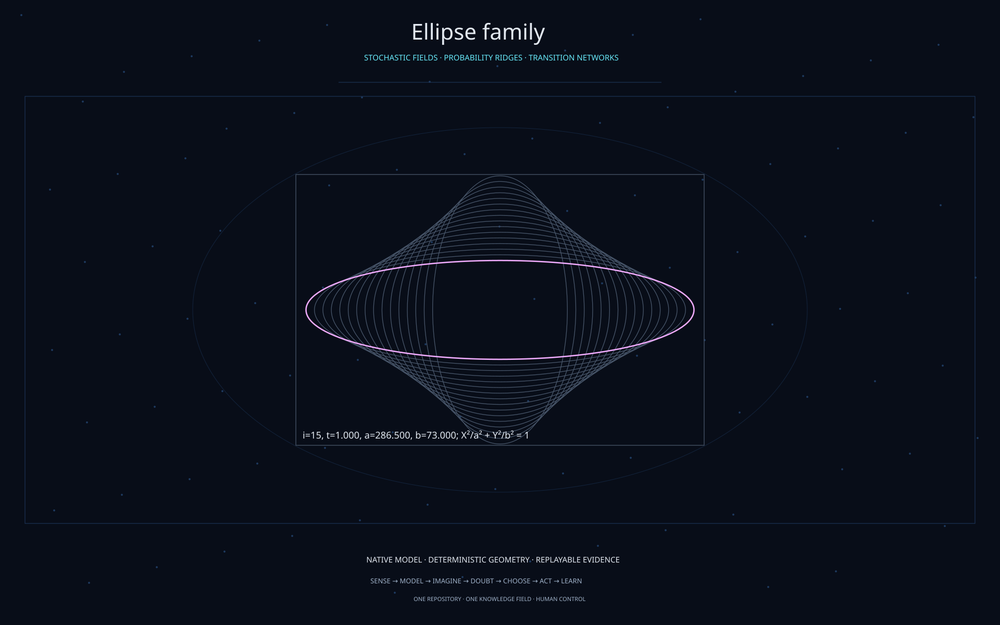

# ZVA-0380 — Zoe Lots Of Ellipses

[Visual archive index](../../README.md) · [Full catalog](../README.md) · [Category: Artwork and generative compositions](../categories/artwork.md)

## What this image shows

The original “Lots of Ellipses” composition: GDPEMANY-inspired ellipse families, stochastic fields, probability ridges, transition networks, and orbital traces combined as creative geometry.

## Role in Zoe

This is part of Zoe’s creative geometry and generative-art practice, preserving the artistic side of the project alongside its scientific instruments.

## Provenance and evidence boundary

**Provenance:** Zoe/allgems project-generated visual.

The image is preserved with its source context; the visual alone does not prove a scientific or operational claim.

## File identity

- Archive ID: **ZVA-0380**
- Visual family: **zoe-lots-of-ellipses**
- Dimensions/format: **SVG 1920×1200**
- Frames: **vector/not applicable**
- Bytes: **23,442**
- SHA-256: `070c2d95def43a57f9b6248b11eed34b3da7143102b5c2f367d3ec2317309333`
- Original file: [Open full resolution](../../images/ZVA-0380.svg)

## Source occurrences

Byte-identical copies are archived once while every known source path remains recorded.

| Source repository/collection | Original path | Canonical link |
|---|---|---|
| zoe | `guiai-lab/docs/images/zoe-lots-of-ellipses.svg` | [Source](https://github.com/Ablation-Tool/zoe/blob/main/guiai-lab/docs/images/zoe-lots-of-ellipses.svg) |

## Related format/size variants

- [ZVA-0310](ZVA-0310.md)
- [ZVA-0311](ZVA-0311.md)
- [ZVA-0379](ZVA-0379.md)
