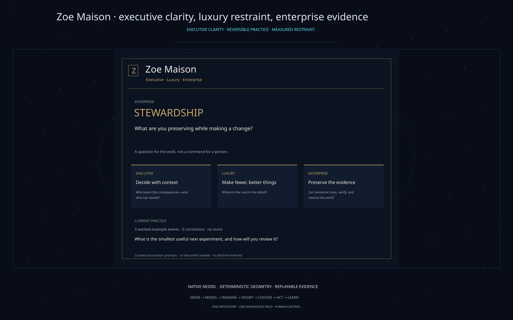

# ZVA-0383 — Zoe Maison

[Visual archive index](../../README.md) · [Full catalog](../README.md) · [Category: Artwork and generative compositions](../categories/artwork.md)

## What this image shows

Zoe Maison’s original design-studio and association deck, here presenting a stewardship prompt and response cards in its ink, pearl, and champagne palette. This is part of Zoe’s creative geometry and generative-art practice, preserving the artistic side of the project alongside its scientific instruments.

## Role in Zoe

This is part of Zoe’s creative geometry and generative-art practice, preserving the artistic side of the project alongside its scientific instruments.

## Provenance and evidence boundary

**Provenance:** Zoe/allgems project-generated visual.

The image is preserved with its source context; the visual alone does not prove a scientific or operational claim.

## File identity

- Archive ID: **ZVA-0383**
- Visual family: **zoe-maison**
- Dimensions/format: **SVG 1920×1200**
- Frames: **vector/not applicable**
- Bytes: **27,938**
- SHA-256: `70e002c2afebef1fd5bf90bda2a3a5ec502b4a119cea92ef6303e7f80f778410`
- Original file: [Open full resolution](../../images/ZVA-0383.svg)

## Source occurrences

Byte-identical copies are archived once while every known source path remains recorded.

| Source repository/collection | Original path | Canonical link |
|---|---|---|
| zoe | `guiai-lab/docs/images/zoe-maison.svg` | [Source](https://github.com/Ablation-Tool/zoe/blob/main/guiai-lab/docs/images/zoe-maison.svg) |

## Documented context

### 43. Zoe maison

Source document: `zoe:research/papers/galleries/zoe-research/README.md`

Complete Zoe research asset index: Zoe maison

`assets/native/zoe-maison.svg`

## Related format/size variants

- [ZVA-0382](ZVA-0382.md)
