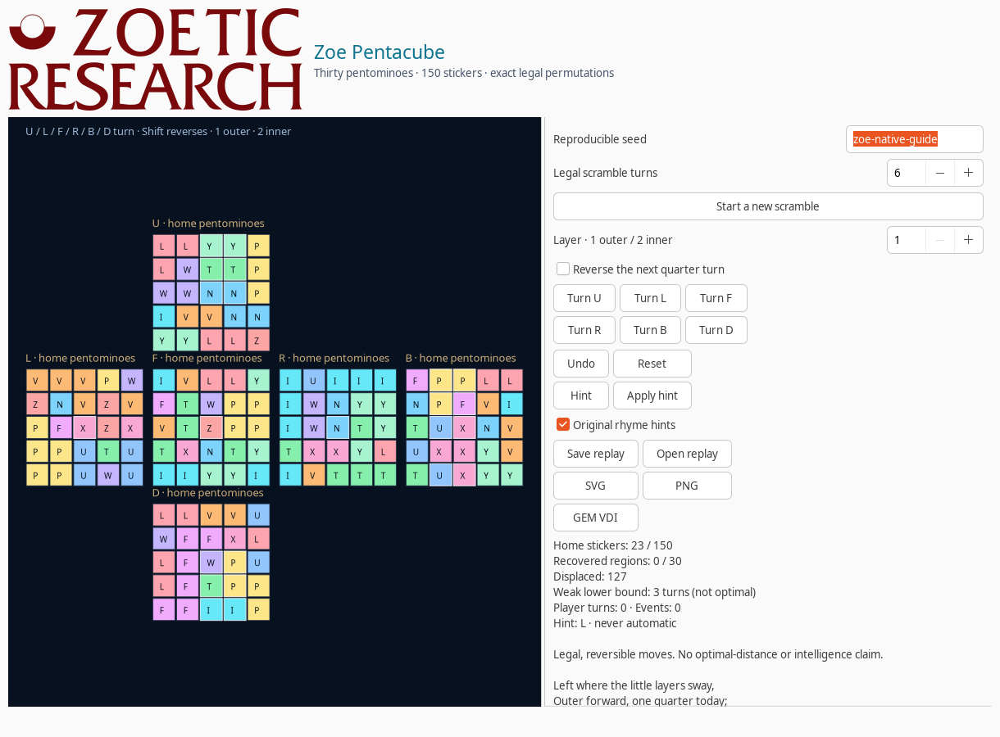

# ZVA-0387 — Zoe Pentacube Native

[Visual archive index](../../README.md) · [Full catalog](../README.md) · [Category: Native interfaces and application scenes](../categories/interface.md)

## What this image shows

Native Zoe Pentacube. This image documents a native, mobile, browser, or desktop interface and its available controls at a particular recorded state.

## Role in Zoe

This image documents a native, mobile, browser, or desktop interface and its available controls at a particular recorded state.

## Provenance and evidence boundary

**Provenance:** Zoe project interface capture.

A screenshot documents the displayed interface state; it is not independent experimental validation.

## File identity

- Archive ID: **ZVA-0387**
- Visual family: **zoe-pentacube-native**
- Dimensions/format: **1220×900 PNG**
- Frames: **1**
- Bytes: **104,378**
- SHA-256: `a38c6bd868788250c97dd56fd260a75dc6fd1636a701c250e83eef73750b8fcc`
- Original file: [Open full resolution](../../images/ZVA-0387.png)

## Source occurrences

Byte-identical copies are archived once while every known source path remains recorded.

| Source repository/collection | Original path | Canonical link |
|---|---|---|
| zoe | `guiai-lab/docs/images/zoe-pentacube-native.png` | [Source](https://github.com/Ablation-Tool/zoe/blob/main/guiai-lab/docs/images/zoe-pentacube-native.png) |

## Documented context

### Play and export

Source document: `zoe:research/papers/zoe-research/docs/native/PENTACUBE.md`

Native Zoe Pentacube

- A hint that reverses one step of the recorded legal path without claiming to be optimal. - An explicit Apply Hint action; no hint moves automatically. - Original rhyme hints, replay save/open, and SVG/PNG/GEM VDI export. - A scrollable control column and accessible face-net description.

### 47. Zoe pentacube native

Source document: `zoe:research/papers/galleries/zoe-research/README.md`

Complete Zoe research asset index: Zoe pentacube native

`assets/native/zoe-pentacube-native.png`

### Play and export

Source document: `zoe:guiai-lab/docs/PENTACUBE.md`

Native Zoe Pentacube

- A hint that reverses one step of the recorded legal path without claiming to be optimal. - An explicit Apply Hint action; no hint moves automatically. - Original rhyme hints, replay save/open, and SVG/PNG/GEM VDI export. - A scrollable control column and accessible face-net description.
