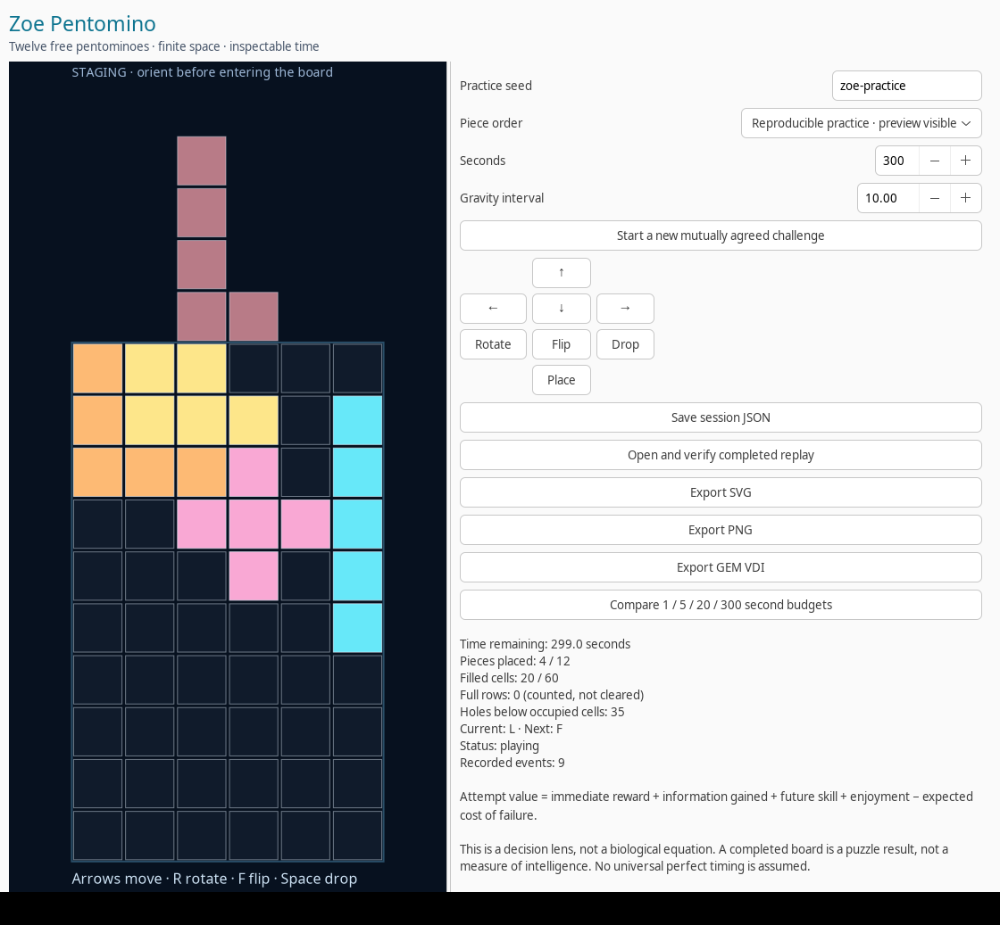

# ZVA-0390 — Zoe Pentomino Native

[Visual archive index](../../README.md) · [Full catalog](../README.md) · [Category: Native interfaces and application scenes](../categories/interface.md)

## What this image shows

Complete Zoe research asset index: Zoe pentomino native. This image documents a native, mobile, browser, or desktop interface and its available controls at a particular recorded state.

## Role in Zoe

This image documents a native, mobile, browser, or desktop interface and its available controls at a particular recorded state.

## Provenance and evidence boundary

**Provenance:** Zoe project interface capture.

A screenshot documents the displayed interface state; it is not independent experimental validation.

## File identity

- Archive ID: **ZVA-0390**
- Visual family: **zoe-pentomino-native**
- Dimensions/format: **1120×1037 PNG**
- Frames: **1**
- Bytes: **78,390**
- SHA-256: `f3b01001bf551446c66b0e8c6d22806d306474ed3c0d71ac3eae07c5d8eabb8b`
- Original file: [Open full resolution](../../images/ZVA-0390.png)

## Source occurrences

Byte-identical copies are archived once while every known source path remains recorded.

| Source repository/collection | Original path | Canonical link |
|---|---|---|
| zoe | `guiai-lab/docs/images/zoe-pentomino-native.png` | [Source](https://github.com/Ablation-Tool/zoe/blob/main/guiai-lab/docs/images/zoe-pentomino-native.png) |

## Documented context

### 50. Zoe pentomino native

Source document: `zoe:research/papers/galleries/zoe-research/README.md`

Complete Zoe research asset index: Zoe pentomino native

`assets/native/zoe-pentomino-native.png`
