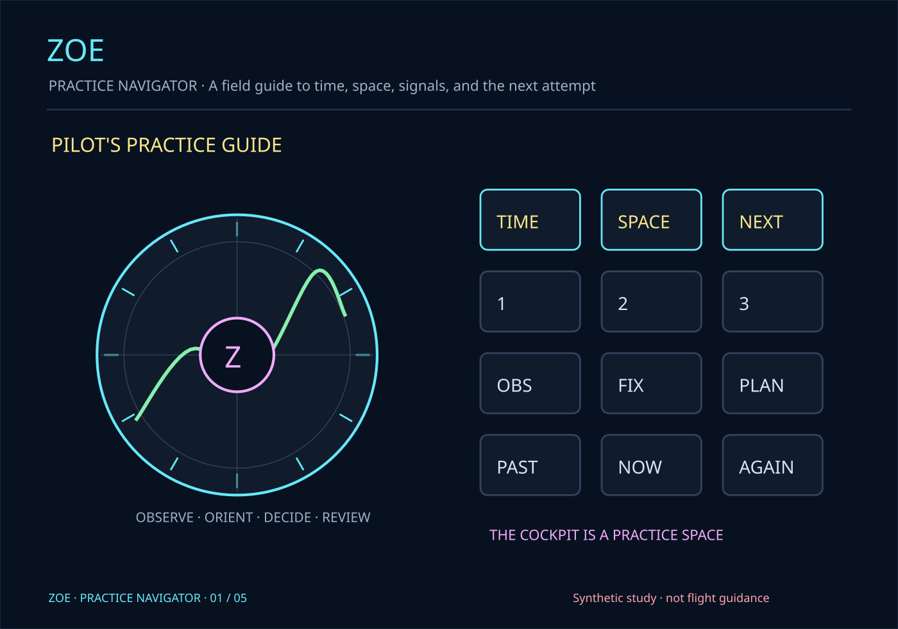

# ZVA-0394 — Zoe Pilot Cover

[Visual archive index](../../README.md) · [Full catalog](../README.md) · [Category: Research figures and measurements](../categories/research-figure.md)

## What this image shows

Complete Zoe research asset index: Zoe pilot cover. This figure preserves a measurement, model output, simulation, geometric construction, or research explanation from the Zoe/allgems program.

## Role in Zoe

This figure preserves a measurement, model output, simulation, geometric construction, or research explanation from the Zoe/allgems program.

## Provenance and evidence boundary

**Provenance:** Zoe/allgems project-generated visual.

The image is preserved with its source context; the visual alone does not prove a scientific or operational claim.

## File identity

- Archive ID: **ZVA-0394**
- Visual family: **zoe-pilot-cover**
- Dimensions/format: **SVG 1400×980**
- Frames: **vector/not applicable**
- Bytes: **16,568**
- SHA-256: `fdcb921e950ce897651bc078400fb859e6c9a57a455f0a71c6618d78af544665`
- Original file: [Open full resolution](../../images/ZVA-0394.svg)

## Source occurrences

Byte-identical copies are archived once while every known source path remains recorded.

| Source repository/collection | Original path | Canonical link |
|---|---|---|
| zoe | `guiai-lab/docs/images/zoe-pilot-cover.svg` | [Source](https://github.com/Ablation-Tool/zoe/blob/main/guiai-lab/docs/images/zoe-pilot-cover.svg) |

## Documented context

### 54. Zoe pilot cover

Source document: `zoe:research/papers/galleries/zoe-research/README.md`

Complete Zoe research asset index: Zoe pilot cover

`assets/native/zoe-pilot-cover.svg`

## Related format/size variants

- [ZVA-0393](ZVA-0393.md)
