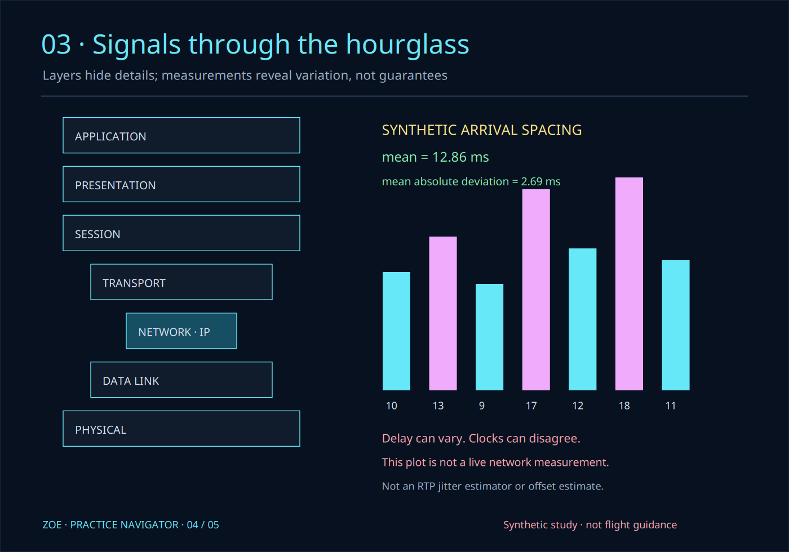

# ZVA-0402 — Zoe Pilot Signals

[Visual archive index](../../README.md) · [Full catalog](../README.md) · [Category: Research figures and measurements](../categories/research-figure.md)

## What this image shows

CERN research in Zoe — Visual research index: Zoe pilot signals. This figure preserves a measurement, model output, simulation, geometric construction, or research explanation from the Zoe/allgems program.

## Role in Zoe

This figure preserves a measurement, model output, simulation, geometric construction, or research explanation from the Zoe/allgems program.

## Provenance and evidence boundary

**Provenance:** Zoe/allgems project-generated visual.

The image is preserved with its source context; the visual alone does not prove a scientific or operational claim.

## File identity

- Archive ID: **ZVA-0402**
- Visual family: **zoe-pilot-signals**
- Dimensions/format: **1400×980 PNG**
- Frames: **1**
- Bytes: **80,271**
- SHA-256: `8b8aca5ebaf6de4632b487ee72594775c3fbc62634423a7d32ba5877db84f4ba`
- Original file: [Open full resolution](../../images/ZVA-0402.png)

## Source occurrences

Byte-identical copies are archived once while every known source path remains recorded.

| Source repository/collection | Original path | Canonical link |
|---|---|---|
| zoe | `guiai-lab/docs/images/zoe-pilot-signals.png` | [Source](https://github.com/Ablation-Tool/zoe/blob/main/guiai-lab/docs/images/zoe-pilot-signals.png) |

## Documented context

### 21. Zoe pilot signals

Source document: `zoe:research/papers/galleries/zoe-cern/README.md`

CERN research in Zoe — Visual research index: Zoe pilot signals

`assets/native/zoe-pilot-signals.png`

### 62. Zoe pilot signals

Source document: `zoe:research/papers/galleries/zoe-research/README.md`

Complete Zoe research asset index: Zoe pilot signals

`assets/native/zoe-pilot-signals.png`

## Related format/size variants

- [ZVA-0403](ZVA-0403.md)
